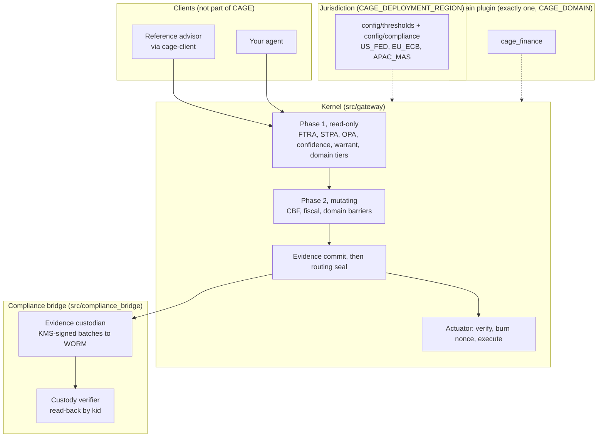

# CAGE — Cybernetic Agent Governance Engine

A runtime control plane that sits between an AI agent and the things it can actually do. Every tool call, spend, and actuation passes through a deterministic policy pipeline that either clears it or refuses it — and writes a signed, tamper-evident receipt either way.

CAGE is domain-agnostic infrastructure. It makes no assumptions about what your agent does, and it does not require you to adopt a particular agent framework, model provider, or cloud.

> This is not an officially supported Google product.

## Contents

- [Objectives](#objectives)
- [See it refuse something (~3 minutes)](#see-it-refuse-something-3-minutes)
- [Bring your own policy format](#bring-your-own-policy-format)
- [Verifiable, not just auditable](#verifiable-not-just-auditable)
- [Domain-agnostic architecture](#domain-agnostic-architecture)
- [Architecture overview](#architecture-overview)
- [Configurable jurisdictional compliance](#configurable-jurisdictional-compliance)
- [Mathematical foundations](#mathematical-foundations)
- [Using CAGE with LangGraph (`cage-client`)](#using-cage-with-langgraph-cage-client)
- [Evaluating on GCP / GKE](#evaluating-on-gcp--gke)
- [Partner integrations](#partner-integrations)
- [Security and compliance status](#security-and-compliance-status)
- [Deployment policy](#deployment-policy)
- [Project structure](#project-structure)
- [When not to use this](#when-not-to-use-this)
- [Project status](#project-status)

## Objectives

CAGE is a reference architecture. It exists to show, in running code, how four properties can be made to hold for an agent that takes consequential actions:

1. **No action without a decision.** An actuator executes only on a single-use, asymmetrically signed routing seal, and a seal is issued only after every planned governance stage has passed.
2. **Refusals are evidence.** A `DENY`, `DEFER` or `REQUIRE_APPROVAL` enters the same hash-chained evidence stream as an `ALLOW`, and in a blocking configuration no decision is returned unless its record was committed.
3. **Hard limits are arithmetic, not judgement.** Budget and safety barriers are checked and committed atomically in the state store, with no model in the path.
4. **Claims are checkable from outside.** An exported trace or evidence stream can be verified by a standalone tool that imports nothing from this repository's `src/`.

It is safety- and security-complete, not commercially complete: market data, broker actuation and ledger feeds are simulated fixtures, while key custody, signing, workload identity and tamper-evident storage are real. It is not a hosted service and holds no authorization to operate; see [Security and compliance status](#security-and-compliance-status).

## See it refuse something (~3 minutes)

```bash
git clone https://github.com/google/cybernetic-agent-governance-engine.git
cd cybernetic-agent-governance-engine
cp .env.example .env
docker compose up -d --build --wait
```

Then drive a governed action into it:

```bash
curl http://localhost:8080/health
uv run python examples/governance_demo.py --no-pause
```

You should see an atomic `ALLOW` and two hard refusals (`FISCAL_CAP_EXCEEDED`) under concurrent load, then a high-risk action deferred to human review with mandatory rationale, then SHA-256 tamper-evident receipt verification.

*Roughly 3 minutes on a cold Docker cache, under a minute warm. Most of the cold time is the container build, not CAGE.*

**What just happened:** the denial was not a model declining to answer. The model was never consulted. A policy evaluated the action against a budget barrier and refused it before the actuation path was reachable, and the refusal is cryptographically attested.

For the full walkthrough, including live OPA policy refusals (`CTRL_OPA_005`) and switching domains, see [`docs/QUICKSTART.md`](docs/QUICKSTART.md).

## Bring your own policy format

CAGE does not ask you to rewrite your policies in a CAGE-specific language. The substrate ingests several existing specifications and compiles them to the same enforcement artifacts:

| Format | Detected by | Spec |
|---|---|---|
| Microsoft ACS | `behaviorDeclarations` | [`agent-control-specification`](https://github.com/microsoft/agent-control-specification) |
| Linux Foundation AAIF | `governedRunLoop` | AAIF working group |
| OSCAL 1.1.x | `oscal-version` | [NIST OSCAL](https://pages.nist.gov/OSCAL/) |
| Lula validation manifest | `kind: LulaValidation` | [lula.dev](https://lula.dev/) |
| Native CAGE YAML | fallback | [`docs/SUBSTRATE_CONTRACT.md`](docs/SUBSTRATE_CONTRACT.md) |

The interface you target is the [Substrate Contract](docs/SUBSTRATE_CONTRACT.md), which carries explicit versioning and deprecation guarantees. It is the part of CAGE we intend other implementations to be able to satisfy.

## Verifiable, not just auditable

Governance claims are worth what you can check. CAGE emits a `GOVERNANCE_TRACE` event stream that can be replayed against a formal model independent of the running system:

```bash
uv run python scripts/check_trace_conformance.py
```

The verifier in [`proof/`](proof/) has no dependency on `src/`, so a trace from any engine can be checked against the same state machine. Mediation coverage is machine-verified by exhaustive model checking rather than asserted in prose. For step-by-step independent verification across offline conformance, local Docker Compose, and clean-room GKE certification (plus a conservative coverage matrix and WORM blast-radius warnings), see [`docs/EVALUATOR_GUIDE.md`](docs/EVALUATOR_GUIDE.md).

## Domain-agnostic architecture

The kernel owns mechanism; a domain plugin owns names and parameters. Everything under [`src/gateway/`](src/gateway/) is mechanism: the atomic barrier script, fence-epoch logic, signature verification, the consensus algorithm, rollback ordering and evidence emission. A plugin declares which actions it claims, which scalar a barrier watches, which threshold key holds the floor, and which tools exist. The barrier condition `h(x) ≥ 0` does not know what `x` means.

| Layer | Path | Role |
|---|---|---|
| **1. Kernel** | [`src/gateway/`](src/gateway/) | Domain- and vendor-neutral enforcement. It may not import a domain plugin, an integration, a vendor SDK, or any LLM client. Gate G3 ([`check_import_boundaries.py`](scripts/check_import_boundaries.py)) enforces this in CI |
| **2. Domain plugins** | `src/cage_<domain>/` | A frozen `PluginContribution` of tiers, invariants, actions, tools and thresholds, assembled once by [`assemble_governor()`](src/gateway/governance/governor/assembly.py). Exactly one per process, named by `CAGE_DOMAIN` |
| **3. Integrations and rails** | [`src/integrations/`](src/integrations/), [`src/compliance_bridge/`](src/compliance_bridge/) | Cloud KMS providers, storage sinks, partner adapters, NeMo and Presidio, evidence custody and OSCAL export |
| **Offline evaluation plane** | [`src/eval_harness/`](src/eval_harness/) | Trajectory and skill evaluation. Separate from online enforcement and never copied into the gateway image |
| **Reference application** | [`src/governed_financial_advisor/`](src/governed_financial_advisor/) | A LangGraph advisor that calls the gateway as a client. It holds no governor and no signing key, and is not part of the platform |

**Deny by default.** A governor assembled with no plugin gets null objects in its engine slots and denies by construction. Startup fails if `CAGE_DOMAIN` is unset or names a plugin with no `DomainConfig`, if two tiers claim one slot, or if an irreversible action in a domain's FTRA registry has no tier claiming it. [`test_bare_kernel_portability.py`](tests/test_bare_kernel_portability.py) and [`test_cage_plugin_validation.py`](tests/test_cage_plugin_validation.py) are the standing tests for the kernel booting without vendor SDKs and for the plugin contract.

### The three shipped domains are not of equal standing

Earlier versions of this README called finance and healthcare "illustrative example domains of equal standing". That is not the case today.

| Domain | Package | Declared `maturity` | Standing |
|---|---|---|---|
| `finance` | [`src/cage_finance/`](src/cage_finance/) | `production` | The only domain the project documents as finalized and production-eligible. Trade confidence, bounding contracts, cash barrier, fiscal pre-reservation and consensus tiers, with the causal tier optional and off by default |
| `healthcare` | [`src/cage_healthcare/`](src/cage_healthcare/) | `stub` | A reference domain. It runs in permissive postures (`dev`, `test`, `ci`, including Docker Compose) and is refused in every enforcing posture |
| `physical_ai` | [`src/cage_physical_ai/`](src/cage_physical_ai/) | `stub` | Declares no `DomainConfig`, so `CAGE_DOMAIN=physical_ai` refuses to start in any posture (`POAM-2026-076`, `POAM-2026-077`) |

**Why healthcare is a stub.** Healthcare has the structure of a production domain: a `DomainConfig`, an FTRA registry, a `dosing.governance` OPA bundle with a unit suite, and a `ControlBarrierFunction` over `SerumConcentrationBarrier`. It has none of the evidence: no domain STPA hazard file (only the kernel's core UCAs apply), a simulated ground-truth provider, and no Gate W run. [`plugin.py`](src/cage_healthcare/plugin.py) therefore declares `maturity = "stub"`, and [`assemble_governor()`](src/gateway/governance/governor/assembly.py) refuses a stub in `staging`, `production` and `local`. Treat it as a demonstration that a second domain plugs in without kernel edits, not as a governed clinical system. The refusal happens at gateway startup, not at Terraform plan time: a plan with `cage_domain = "healthcare"` succeeds and the gateway then refuses to start.

To add a domain, see [`docs/architecture/EXTENSIBILITY_ARCHITECTURE.md`](docs/architecture/EXTENSIBILITY_ARCHITECTURE.md).

## Architecture overview

```text
agent → gateway → [ FTRA → STPA → OPA → confidence → warrant* → consensus → CBF → fiscal ]
                            ↓                                                    ↓
                     refuse + receipt                                     clear + receipt
```

\* `warrant` applies only to norms the active region marks `requires_warrant`.

By default every tier is deterministic and needs no model. `consensus` escalates an action at or above its threshold to a human; LLM critics are optional. The diagram shows the seven tiers of the formal model in [`proof/`](proof/), plus `warrant`. Domain plugins contribute tiers of their own, such as finance's `bounding` and healthcare's `dose_barrier`, and the finance causal tier is an optional extension, off by default.



| Subsystem | Path | Role |
|---|---|---|
| Symbolic governor | [`src/gateway/governance/governor/`](src/gateway/governance/governor/) | Immutable governor built only by the composition root; two-phase pipeline, reservation scope and rollback. [`SYMBOLIC_GOVERNOR_RUNTIME.md`](docs/architecture/SYMBOLIC_GOVERNOR_RUNTIME.md) |
| FTRA reachability | [`src/gateway/governance/ftra/`](src/gateway/governance/ftra/) | Classifies the terminal steps of an execution plan as reversible or irreversible before anything runs. [`FTRA_REACHABILITY_ANALYZER.md`](docs/architecture/FTRA_REACHABILITY_ANALYZER.md) |
| Control barrier engine | [`src/gateway/governance/safety/`](src/gateway/governance/safety/) | Invariant-parametric barrier with a settlement-aware debit ledger |
| Routing seal and signer | [`routing_seal.py`](src/gateway/governance/routing_seal.py), [`kms_signer.py`](src/gateway/governance/kms_signer.py) | Asymmetric JWT seals, single-use nonce consumption, per-workload keys. [`CRYPTOGRAPHIC_SIGNER_ENGINE.md`](docs/architecture/CRYPTOGRAPHIC_SIGNER_ENGINE.md) |
| Evidence stream | [`src/gateway/governance/evidence/`](src/gateway/governance/evidence/) | Hash-chained Redis stream, state commitments, cold store. [`EVIDENCE_CHAIN.md`](docs/architecture/EVIDENCE_CHAIN.md) |
| Deferral queue | [`defer_queue.py`](src/gateway/governance/defer_queue.py) | Parks `DEFER` and `REQUIRE_APPROVAL`; distinct-principal quorum; single-use post-approval revalidation. [`DEFERRAL_QUEUE.md`](docs/architecture/DEFERRAL_QUEUE.md) |
| Consequence gateway | [`consequence_gateway.py`](src/gateway/governance/consequence_gateway.py) | Verifies and consumes single-use consequence tokens for callers that present one. [`CONSEQUENCE_GATEWAY.md`](docs/architecture/CONSEQUENCE_GATEWAY.md) |
| Ingress identity | [`workload_identity.py`](src/gateway/server/workload_identity.py) | Accepts a caller identity only from the pod's own mesh proxy; no anonymous principal |
| Seam contracts | [`src/gateway/governance/seams/`](src/gateway/governance/seams/) | Protocols external adapters implement: normative, attestation, actuation, quarantine, warrant, estate and others |
| Compliance bridge | [`src/compliance_bridge/`](src/compliance_bridge/) | Evidence custody, read-back verification, OSCAL export, deferral API, operator OIDC verification |
| Integrations | [`src/integrations/`](src/integrations/) | `gcp`/`aws`/`azure` KMS providers, `storage_gcs`/`storage_s3`, `nemo`, `presidio`, `telemetry_langfuse`, `gcp_eval`, and partner adapters `provider_01`–`provider_08`, `actuator_01`–`actuator_03` |

**Retired since the earlier full README.** These appear in older documentation and no longer exist: the ClickHouse evidence sink (Redis Streams plus WORM storage are the only evidence custody; ClickHouse remains only as Langfuse's own store), the GEAP agent runtime and Agent Gateway adapter, `agent_catalog.rego`, the `caller_identity` and `hitl_escalator` modules and the `X-Agent-ID` header path they served, the `deployment/k8s/` manifests (Terraform under [`infra/`](infra/) is the only deployment path), the cloud-agnostic Terraform target (`2bacc478:infra/targets/agnostic/main.tf`), and the in-tree client mirror (`1684fce8^:src/gateway/client/__init__.py`). AgentSight has no active producer and is tracked for retirement under `POAM-2026-193`.

Deeper material: [`GATEWAY_ARCHITECTURE.md`](docs/architecture/GATEWAY_ARCHITECTURE.md), [`TECH_STACK.md`](docs/architecture/TECH_STACK.md), [`AGENT_SYSTEM_ARCHITECTURE.md`](docs/architecture/AGENT_SYSTEM_ARCHITECTURE.md) and [`FORMAL_VERIFICATION.md`](docs/architecture/FORMAL_VERIFICATION.md).

## Configurable jurisdictional compliance

[`resolve_deployment_region()`](src/gateway/governance/env_posture.py) is the only reader of `CAGE_DEPLOYMENT_REGION`. It requires an exact, case-sensitive match (after surrounding whitespace is stripped) against `US_FED`, `EU_ECB` or `APAC_MAS`: any other value — including `LOCAL` or lowercase — is refused in every posture, and an unset or blank value is refused in enforcing postures (`production`, `staging`, `local`) and resolves to `US_FED` only in `dev`, `test` and `ci`. Every region-dependent control (including evidence cold-store bucket selection) takes its region from that resolver, so they cannot disagree. There is no `LOCAL` jurisdiction or residency rule.

Jurisdiction and geography are coupled at deployment and in every enforcing runtime posture. Terraform preconditions ([`infra/targets/gcp-gke/main.tf`](infra/targets/gcp-gke/main.tf) `DEP-10` and [`infra/modules/worm_bucket/main.tf`](infra/modules/worm_bucket/main.tf)) require the deployment's GCP region to match the jurisdiction (`europe-*` for `EU_ECB`, `asia-*` for `APAC_MAS`, `us-*` for `US_FED`). At runtime, [`resolve_cold_store_bucket()`](src/gateway/governance/evidence/residency.py) enforces geographic residency across all enforcing postures (`production`, `staging`, `local`), requiring `EVIDENCE_COLD_STORE_LOCATION` — injected into `compliance-bridge` from `module.worm_bucket.bucket_location`, the WORM bucket's immutable cloud location — to belong to the region's `allowed_locations` in [`residency.json`](config/compliance/residency.json) (neither bucket-name prefixes nor the caller pod's `GOOGLE_CLOUD_LOCATION` / `AWS_REGION` satisfy it; only `dev`, `test` and `ci` skip location validation). Certified Gate W run `8956f505` ran in `US_FED` before this lock, while `staging` still bypassed geographic validation (`residency_result_breakdown` and `next_gate_w_discharge` in [`gate_w_certification.json`](compliance/gate_w_certification.json); `POAM-2026-220`), and `EU_ECB` and `APAC_MAS` controls have so far been exercised by in-process regional test suites rather than on an in-region cluster. Individual stream records name the jurisdiction (`region`) without stamping whether residency was checked, while KMS-signed `cage-evidence-batch/2` custody attestations stamp `deployment_posture` (`production` or `staging`; pre-stamping `v1` archives surface `posture_status="unstamped_v1"` and `citable_qualifications=["unstamped_v1_posture"]`).

| Region | Frameworks mapped | Thresholds |
|---|---|---|
| `US_FED` | NIST SP 800-53 Rev 5, NIST AI 600-1, SR 26-2 | [`US_FED_BASELINE.json`](config/thresholds/US_FED_BASELINE.json) |
| `EU_ECB` | EU AI Act, GDPR, DORA | [`EU_ECB_BASELINE.json`](config/thresholds/EU_ECB_BASELINE.json) |
| `APAC_MAS` | MAS FEAT, MAS Notice 655, MAS TRM | [`APAC_MAS_BASELINE.json`](config/thresholds/APAC_MAS_BASELINE.json) |

ISO/IEC 42001 is the baseline in all three. Each regional file overrides the kernel defaults in [`config/governance_thresholds.json`](config/governance_thresholds.json), and [`config/compliance/`](config/compliance/) holds the control mappings.

What the region changes at runtime, for the finance domain:

| Parameter | `US_FED` | `EU_ECB` | `APAC_MAS` |
|---|---|---|---|
| Minimum trade confidence | 0.95 | 0.97, warranted | 0.96 |
| Consensus escalation threshold | 10,000 | 7,500 | 8,500 |
| Barrier decay `γ` | 0.5 | 0.6 | 0.55 |
| Drawdown limit (UCA-5) | 4.5% | 3.5% | 4.0% |
| Order share of daily volume (UCA-6) | 1% | 0.5% | 0.8% |
| Extra tier | none | `fria` (EU AI Act Art. 27) | none |

`EU_ECB` adds the [`fria` tier](src/gateway/governance/jurisdiction/eu_ai_act/fria_tier.py), and an enforcing `EU_ECB` posture refuses to start on the static stub provider. The `EU_ECB` trade-confidence floor is a warranted norm, so relying on it requires a verified warrant, checked per request by the kernel warrant stage.

### What is and is not a software control

Mapping a framework is not the same as implementing it. Of the 33 Lula validation manifests under [`compliance/lula/`](compliance/lula/), 26 are evaluated by the in-cluster audit job and Gate W, 5 are adopter-operated, and 2 are planned. Of the 26 evaluated, the [Lula README](compliance/lula/README.md) rates 12 Active and 14 as stubs that may not be cited as evidence:

- **Rated Active is not the same as tested.** Six manifests rated Active described checks their Rego no longer made: one schema migration, `#664`, removed the assertions and left the descriptions. Four of them are now rated Stub, among them `ftra`, which asserts only that a gateway container exists, and `eu-fria`, which accepts any region and checks neither the `fria` tier nor the normative provider. `iso001-token-quota` has its policy check back, and `sc8` stays Active for the one check it makes, Memorystore CA pinning. Every Active row now names the rules its manifest's `validate` composes, and a test fails when a row and its Rego disagree. That test compares names, so a second check, in [`check_k8s_terraform_parity.py`](scripts/check_k8s_terraform_parity.py), fails an Active manifest that selects an object `infra/` does not create; before `#664`, every object `ftra` selected by name was one. Neither check judges whether a rule checks enough of what it selects ([`POAM-2026-219`](docs/POAM.md)).
- **Five adopter-operated controls, marked `not-applicable`.** These are institutional obligations outside the software boundary, kept as templates for the deploying institution: EU AI Act Art. 9 (organizational risk management), DORA Art. 10 (incident detection and classification), MAS FEAT (fairness sign-off), MAS Notice 655 (recovery objectives and notification), and MAS TRM §6.3 (model risk inventory). CAGE does not claim to satisfy them.
- **`RA-5` is planned, under `POAM-2026-010`.** Vulnerability scanning runs in CI. The in-cluster scanning CronJob the manifest checks for is not deployed.
- **GDPR Art. 22 is split.** Human oversight is implemented at runtime: `REQUIRE_APPROVAL` parks the action for a distinct-principal quorum, and an approval is revalidated once before execution. The data subject's right to contest a decision (Art. 22(3)) and the `/v1/compliance/gdpr/art22` status endpoint are planned, under `EU-006`.

Three limits on the "configurable" claim, all open:

- Adding a region is not configuration-only. The region set is a constant in [`constants.py`](src/gateway/governance/constants.py).
- Domains and jurisdictions do not compose independently. A plugin's compliance overlay can redefine a kernel control, including one a jurisdictional tier enforces on (`POAM-2026-121`, `POAM-2026-123`).
- The regional tier-1 keywords in the EU and APAC overlays are not loaded; every region uses the same global list (`POAM-2026-128`).

[`docs/operations/JURISDICTION_INVENTORY.md`](docs/operations/JURISDICTION_INVENTORY.md) lists what each region actually sets.

## Mathematical foundations

Each formula below was checked against the cited source at HEAD. Derivations are in [`FORMAL_VERIFICATION.md`](docs/architecture/FORMAL_VERIFICATION.md) and [`CAUSAL_AND_CBF_GOVERNANCE.md`](docs/governance/CAUSAL_AND_CBF_GOVERNANCE.md).

### Control barrier function

Source: [`cbf_engine.py`](src/gateway/governance/safety/cbf_engine.py) (`LUA_ATOMIC_CBF`)

The safe set is `S = {x : h(x) ≥ 0}` with the affine barrier `h(x) = x − threshold`, for whichever `InvariantModel` the active domain contributes. Finance's [`CashBarrier`](src/cage_finance/invariants.py) gives `h = cash_balance − min_cash_balance`. For an action of cost `c` against current state `x`:

```text
h(t)   = x − threshold
h(t+1) = (x − c) − threshold
commit  iff  h(t+1) ≥ (1 − γ) · h(t)   and   h(t+1) ≥ 0,      γ ∈ (0, 1]
```

Since `h(t+1) = h(t) − c`, the first condition is `c ≤ γ · h(t)`: one action may spend at most a fraction `γ` of the remaining headroom, so the floor is approached geometrically and never crossed. The check, the state write, the fence-epoch increment and the debit-ledger entry happen in one Redis Lua script, so no two concurrent requests can both pass against the same balance.

When an external ground truth is available, `x` is the reconciler's attested value minus the total of debits admitted since it. The engine verifies that snapshot against the reconciler's own key and refuses if it changed between the read and the commit. The shipped reconciler feed is a simulated provider (`POAM-2026-096`).

### Seven-tier, two-phase pipeline

Sources: [`pipeline.py`](src/gateway/governance/governor/pipeline.py), [`proof/model.py`](proof/model.py)

| Phase | Tier | Stage | Mechanism |
|---|---|---|---|
| 1 | 0.5 | `ftra` | Reachability and irreversibility classification of the plan |
| 1 | 1 | `stpa` | Unsafe-control-action rules |
| 1 | 3b | `opa` | The active domain's Rego package |
| 1 | 2 | `confidence` | Agent confidence against the region's threshold |
| 1 | 5 | `consensus` | Deterministic escalation at or above the consensus threshold; LLM critics optional |
| 2 | 3a | `cbf` | Atomic barrier check and commit |
| 2 | 4 | `fiscal` | Atomic pre-reservation of the daily cap |

Tier numbers follow the formal model's `TIER_LABELS`; the order is execution order. Phase 1 stages are read-only. Phase 2 stages mutate, and `phase2_mode()` decides how they run:

- any `HARD` phase 1 finding skips phase 2;
- any other phase 1 finding, or a dry run, previews phase 2 without writing;
- only a clean phase 1 under a committing profile commits.

A refusal in phase 1 therefore never consumes budget. After a human approves, every mutating stage and the `opa` and `warrant` stages run again, because state and policy can change while a request waits.

The formal model was eight tiers when the causal tier was mandatory. It is seven now, and the model enumerates 34 reachable states for the gated pipeline, 17 for the ungated variant that violates the invariant, 31 with a skipped tier, and 38 for `EU_ECB` with `fria`. The proved property is `NoDirectBind`: the system reaches `EXECUTED` only through a transition guarded by a resolved allow.

### Confidence bands and confabulation risk

Sources: [`stages/confidence.py`](src/gateway/governance/governor/stages/confidence.py), [`confabulation_scorer.py`](src/gateway/governance/confabulation_scorer.py)

For self-reported confidence `s`, with `agent_threshold = 0.95` and `defer_floor = 0.70`:

| Condition | Finding | Verdict |
|---|---|---|
| `s` missing, non-numeric, NaN, infinite, outside `[0, 1]`, or prompt injection flagged | `HARD` | `DENY` |
| `s < 0.70` | deferrable | `DEFER` |
| `0.70 ≤ s < 0.95` | human review | `REQUIRE_APPROVAL` |
| `s ≥ 0.95` | none | passes this stage |

The earlier README said scores below 0.70 were hard-denied. They defer.

`risk_score = 1.0 − confidence` is a telemetry score. It is recorded for audit and is not a pipeline stage.

### Causal marginal risk boundary and slope guard

Source: [`causal/gatekeeper.py`](src/gateway/governance/causal/gatekeeper.py)

The causal tier is opt-in (`CAGE_CAUSAL_TIER_ENABLED`, off by default). With `β` the causal slope fitted on the treatment divided by `normalization_scale` (10,000 by default):

```text
β ≤ 0                                              →  block (slope guard)
risk = min(1, max(0, 0.5 + β · treatment / scale))
risk > 0.95                                        →  block
```

The trip point is `0.45 · scale / β`. Placebo refutation permutes the treatment column over 50 simulations and refuses the world model when the p-value is below 0.05, the placebo effect exceeds 0.2, the result is missing or non-finite, or the simulated effects have no spread. A regression whose rounding-error bound exceeds `1e-6` is refused before it is fitted.

Do not rely on this tier as a risk control:

- Neither refusal path could refuse in 3.0.0–3.3.0 (GHSA-c8pw-f3g3-xg7c, fixed in 4.0.0).
- The prediction has no volatility term and its `0.5` is neither configured nor estimated, so the boundary can fail open as volatility rises (`POAM-2026-117`, open).
- No enforcing posture has a live world-model feed, so when enabled there it denies every trade (`POAM-2026-094`, open).

### Routing seal integrity

Source: [`routing_seal.py`](src/gateway/governance/routing_seal.py)

A seal is a version 3 JWT, asymmetrically signed by the gateway's key. It is not an HMAC token.

- **Claims:** `action_hash`, `canon`, `record_hash`, `nonce`, `iat`, `exp`, `iss`, `aud`, with `alg` and `kid` in the header. `action_hash` is SHA-256 over the RFC 8785 canonical bytes of `(action, params)`; parameters the canonical form cannot represent exactly are refused before any evidence is written.
- **Evidence binding:** `generate_seal_with_evidence()` blocks on a durable evidence commit and binds the committed `record_hash` into the seal. If the commit fails, it raises `EvidenceChainUnavailableError` and issues nothing. At consumption the claim must match an index written at issuance, so a seal whose `record_hash` never came from a commit cannot be consumed even if its signature verifies.
- **Verification:** the key is resolved by `kid` from the trust anchor, never from the token, and the accepted algorithms are `ES256`/`ES384`/`ES512` for an EC key or `EdDSA` for Ed25519.
- **Single use:** after verification, one Lua `SET NX` on the nonce admits exactly one of any racing callers. The default lifetime is 30 seconds (`GOVERNANCE_SEAL_TTL_S`).
- **Key custody:** enforcing postures require a cloud KMS key and refuse to start on a software key. The certified GKE run used an HSM-backed P-256 key. Docker Compose signs with an in-memory Ed25519 key.

A version 2 HMAC-SHA256 path remains in the module for test environments with no signer. `CAGE_SEAL_STRICT_MODE` defaults to `true`, and in strict mode or any production environment an HMAC seal is rejected, which closes the downgrade.

### Evidence and provenance hash chains

Sources: [`evidence/stream.py`](src/gateway/governance/evidence/stream.py), [`proof/stream_invariants.py`](proof/stream_invariants.py), [`provenance_chain.py`](src/gateway/governance/provenance_chain.py)

The authoritative record is the `cage-audit/3.0` evidence stream. Each record carries

```text
record_hash = SHA-256( prev_hash ‖ JCS(header) ‖ payload_json )
```

with contiguous sequence numbers from a genesis record whose `prev_hash` is empty. Altering, removing or reordering a record breaks every later link, and verification is one pass over the stream. Link hashes are unkeyed, so a chain alone shows internal consistency, not who wrote it. Origin and deployment posture come from the compliance bridge's KMS-signed `cage-evidence-batch/2` batch attestations (`deployment_posture` in `{"production", "staging"}`; pre-stamping `v1` archives verify with `posture_status="unstamped_v1"` and `citable_qualifications=["unstamped_v1_posture"]`) in retention-locked storage, corroborated against the KMS audit log.

`provenance_chain.py` is a separate per-node chain library: each record holds SHA-256 digests of a node's input and output plus `parent_hash`, and a record's own hash is SHA-256 over the canonical JSON of the whole record. Nothing in production calls it, so it records, signs and persists nothing and is not part of the evidence path (`POAM-2026-246`).

### Fiscal limit guard

Source: [`fiscal_limit_guard.py`](src/cage_finance/safety/fiscal_limit_guard.py)

A daily cap, $500,000 by default (`FISCAL_DAILY_CAP_USD`), is held as integer cents under one key per UTC calendar day:

```text
reserve(a):  if current + a > cap  →  reject
             else current ← current + a, and record a pending reservation
```

The comparison and the increment are one Redis Lua script. The earlier README described `WATCH/MULTI/EXEC` optimistic locking with backoff and a rolling window; neither is how it works now. A reservation is then confirmed when the sealed action executes, released if it does not, or reclaimed after 300 seconds unsettled, and each of those transitions happens at most once. Any Redis error rejects the reservation.

One gap is documented in the module: a crash after the trade and before `confirm()` lets the reservation expire, so that spend is under-counted for the rest of the day.

### STPA unsafe control actions

Sources: [`config/stpa/core_system.yaml`](config/stpa/core_system.yaml) (kernel), [`trade_hazards.yaml`](src/cage_finance/config/stpa/trade_hazards.yaml) (finance)

| UCA | Unsafe when | `US_FED` / `EU_ECB` / `APAC_MAS` | Declared targets |
|---|---|---|---|
| UCA-1 | `write_db` with no `approval_token` | n/a | OPA, Python, sandbox |
| UCA-7 | `semantic_score > 0.85` on a prompt-injection check | n/a | OPA, Python |
| UCA-2 (FIN-2) | `latency_ms > max_latency_ms` | 200 / 150 / 175 ms | OPA, Python, sandbox |
| UCA-5 | `drawdown > uca5_drawdown_threshold_pct` | 4.5 / 3.5 / 4.0 % | OPA, Python |
| UCA-6 | `order_size > uca6_max_order_volume_fraction × daily_vol` | 1 / 0.5 / 0.8 % | OPA, Python |
| UCA-13 (FIN-1) | a sell with `amount > max_sell_portfolio_fraction × portfolio_total` | 10 / 8 / 9 % | OPA, Python |

`drawdown`, `latency_ms`, `order_size`, `daily_vol` and `portfolio_total` are bound by the gateway, and a caller's value is dropped. UCA-3, 4, 8, 9, 10 and 12 are advisory.

The last column lists the targets each UCA declares, not what is loaded at runtime. Which generated artifacts are actually evaluated is graded in [`OSCAL_EVIDENCE_CLAIM_REGISTER.md`](docs/compliance/OSCAL_EVIDENCE_CLAIM_REGISTER.md), which rates the compiler's coverage claim weaker than written. The hazard analysis is in [`STPA_ANALYSIS.md`](docs/security/STPA_ANALYSIS.md).

## Using CAGE with LangGraph (`cage-client`)

[`packages/cage-client`](packages/cage-client/) 0.3.0 is the policy enforcement point for an application that uses CAGE as a service. It is the first release that works: 0.1.0 and 0.2.0 never completed a call against a live gateway and verified no signature.

```bash
pip install https://github.com/google/cybernetic-agent-governance-engine/releases/download/client-v0.3.0/cage_client-0.3.0-py3-none-any.whl
# or from source, with the LangGraph extra:
pip install "cage-client[langgraph] @ git+https://github.com/google/cybernetic-agent-governance-engine.git#subdirectory=packages/cage-client"
```

```python
from cage_client import CageClient
from cage_client.adapters.langgraph import cage_guard

cage = CageClient(gateway_url="http://localhost:8080")


@cage_guard(client=cage, action="execute_trade")
async def trade_execution_node(state: dict) -> dict:
    # Runs only after the gateway's ALLOW envelope has been verified.
    return {"trade_status": "EXECUTED"}
```

The guard reads the action's parameters from `state["proposed_action"]`, optional context from `state["context"]` and the agent identifier from `state["agent_id"]`, then calls the gateway before the node body runs.

### What the client verifies, by default

Every HTTP 200 envelope is checked before the client returns or acts on its verdict:

1. **Key resolution out of band.** The signing key is looked up by `kid` from `{gateway_url}/governance/.well-known/jwks.json`, or from keys you pin with `public_keys={kid: pem}`. An envelope that carries its own key (`jwk`, `jku`, `x5c` and similar) is refused. The key set refreshes after 300 seconds and is evicted, failing closed, after 3,600 seconds stale.
2. **Two algorithms only.** `ES256` on P-256 and `EdDSA` on Ed25519, the two the gateway signs with. Any other algorithm or key type is rejected, and a key set containing any other key is refused whole.
3. **Signature over canonical bytes** (RFC 8785).
4. **Freshness.** `expires_at` must be in the future within a 5-second skew, and later than `issued_at`.
5. **Request binding.** `subject.action` and `subject.action_hash` must match what was submitted, so an envelope for one request cannot answer another.

The response is parsed as strict JSON, and nothing is stripped or coerced before the signed values are read. Turning any check off raises at construction unless `CAGE_ENV` is a development or test posture. TLS or mTLS protects the channel and does not replace this.

### Outcomes

| Gateway outcome | Client behaviour |
|---|---|
| Verified `ALLOW` | Returns the envelope; the guard runs the node |
| `DENY` or `NARROW` (HTTP 403, 422, or a 200 carrying that verdict) | Raises `PolicyViolationException` with `reason_code`, `violation_details`, `audit_id` |
| `DEFER` or `REQUIRE_APPROVAL` | Raises `DeferralPending` with `ticket_id`, `defer_reason`, `expires_at` |
| Signature, freshness or binding failure | Raises `RoutingSealVerificationError` |
| Network failure, 5xx, malformed body | Raises; the node does not run |

### The reference advisor uses the same wheel

The advisor in this repository is not a special case. Its [`GatewayClient`](src/governed_financial_advisor/infrastructure/gateway_client.py) delegates `validate_action()` to `CageClient` from the published `client-v0.3.0` wheel and routes on a verdict only after the envelope verifies. A transport adapter sends the SDK's requests through the advisor's own HTTP client, which keeps its trace headers, principal header and retry budget. That is the pattern to copy when your application already owns an HTTP client.

The in-tree mirror of the client under the gateway package is retired. [`check_client_sdk_sync.py`](scripts/check_client_sdk_sync.py) fails if a file reappears there, if anything imports it, or if the dependency stops being a built wheel.

For code that lives inside this repository, such as a new domain plugin, the node factories in [`langgraph_harness/`](src/gateway/governance/langgraph_harness/) embed the checks in process. Everything else should use the client.

More: [`packages/cage-client/README.md`](packages/cage-client/README.md), [`LANGGRAPH_QUICKSTART.md`](docs/guides/LANGGRAPH_QUICKSTART.md), and the [tutorial notebook](docs/guides/langgraph_governance_tutorial.ipynb).

## Evaluating on GCP / GKE

Docker Compose shows that the governance logic works. It cannot show that the infrastructure isolates it. That boundary is the reason to run on GKE:

| | Docker Compose | Fresh GCP project (Gate W) |
|---|---|---|
| Exercises | Policy evaluation, seal mint/verify/consume, barrier and fiscal reservation, refusal receipts, live evidence stream | All of that, plus the items below |
| Signing key | In-memory Ed25519, development only | Per-workload HSM keys in Cloud KMS |
| Caller identity | Development loopback opt-in | Linkerd mTLS and `NetworkPolicy` |
| Evidence custody | Container Redis, lost on teardown | KMS-signed batches in retention-locked storage, verified across a rebuild |
| Continuous compliance | Not present | In-cluster Lula audit job with a dead-man's switch (**Note (`POAM-2026-230`):** enforcing postures require a verified Cloud Monitoring notification channel and external notifier; in CAGE's reference architecture the verified terminal sink is GCP Cloud Pub/Sub, while downstream human paging fan-out is adopter-operated) |
| Image admission | Not present | Binary Authorization, with a negative probe |

A green Compose run is evidence about application logic only. The per-property grading of what each path exercises, partially exercises, or does not exercise is the coverage matrix in [`docs/EVALUATOR_GUIDE.md`](docs/EVALUATOR_GUIDE.md) §2, and this README does not restate it.

### Before you start

- **Use a new, disposable project.** [`staging_lifecycle.sh`](scripts/staging_lifecycle.sh) creates the project you name and links your billing account. Never point it at a project you operate: evidence buckets are retention-locked, a locked bucket cannot be emptied or deleted before the lock expires, and the lock places a lien on the project. Staging locks for one day. Read [Evaluator Guide §3](docs/EVALUATOR_GUIDE.md#3-worm-contamination--shared-instance-blast-radius-warning) first.
- **Permissions:** project creator, billing user, and private log viewer for the KMS audit-log read-back.
- **Run from a Linux x86_64 machine with a static egress IP.** The script authorizes that address on the private cluster's control plane. It needs `gcloud`, `terraform`, `kubectl`, `helm`, `jq`, `lula` v0.16.0 and `uv`.
- **Images are built by Cloud Build**, never a local Docker daemon.

### Run it

```bash
./scripts/staging_lifecycle.sh \
  --fresh-project=<PROJECT_ID> \
  --billing-account=<BILLING_ACCOUNT> \
  --enable-e2e-advisor \
  --archive-dir=artifacts/gate-w-eval
```

Add `--allow-partner-outage` if you hold no partner sandbox credentials. First-party gates stay fail-closed, and the manifest records `partner_conformance_status: unreachable_waived` instead of claiming partner coverage.

What happens, in order:

| Phase | What runs |
|---|---|
| 0 | Records that the project did not exist, creates it, and runs [`bootstrap_gcp_project.sh`](scripts/bootstrap_gcp_project.sh) |
| 1 | [`deploy_all.sh`](deploy_all.sh) builds and attests images and applies Terraform; a second plan must show zero drift |
| 2 | Every workload ready with zero container restarts; the audit CronJob active |
| 3 | Host and in-cluster Lula validation with no startup grace; evidence custody read back |
| 4 | Regional suites, residency checks of configuration and the evidence bucket's location, and a Binary Authorization probe with an unattested image |
| 5 | Live integration and advisor end-to-end suites, metrics read-back, KMS audit-log corroboration |
| 6 | Teardown, rebuild, proof that the new evidence chain is bound to the old one, final destroy and survivor check |

`bootstrap_gcp_project.sh` does what Terraform cannot do for itself on an empty project: it enables the required APIs, creates the remote state bucket, and pre-creates the Cloud Build service account, signing keyring, attestor key, Container Analysis note and Binary Authorization attestor, so images can be built and attested before the first apply. It also removes the broad default roles from the default compute service account. With `--import-state` it imports foundational resources that survive a destroy.

Every run writes a self-contained bundle to the archive directory. Start with `manifest.json`, which records the overall verdict, per-phase failures, and plain-language disclosures of what was not verified. The phase-by-phase read-back and the archive layout are in §1c of the [Evaluator Guide](docs/EVALUATOR_GUIDE.md).

To deploy without the validation cycle, into a project you have already bootstrapped:

```bash
./deploy_all.sh --target gcp-gke --env staging --var project_id=<PROJECT_ID>
```

The default run deploys `US_FED` in `us-central1`. Its residency phase checks configuration and one live fact, that the evidence WORM bucket is in a US location; the checks written for an `EU_ECB` deployment are skipped. It does not exercise the gateway's own residency enforcement, which staging switches off by design (see [Configurable jurisdictional compliance](#configurable-jurisdictional-compliance)). A run in a European or Asian region would check where that run's infrastructure sits, and still not the enforcement.

## Partner integrations

Third-party adapters live under [`src/integrations/`](src/integrations/) behind anonymized slots, and their status is reported by what has run over the wire, not by what is implemented. Of eleven partner slots, three (`provider_01`, `provider_05`, `provider_08`) have passed live in the partner harness on `main`. Four (`provider_02`, `provider_03`, `provider_07`, `actuator_01`) are harness targets that are not run, each blocked on sandbox credentials or an endpoint, and the remaining four have no harness target. Recent work (`cage-conformance` 0.4.1 with `verify --endpoint --profile`, corrected wire vectors, a standalone `conformance-v*` release job, and receipt and envelope fixes in three adapters) moved no partner between those groups. It added one live result: on 2026-11-14 the `provider-01-v0.2` endpoint profile passed against the `provider_01` sandbox from the published 0.4.1 wheel. The fixes for unprovisioned partners are verified hermetically only. The certified Gate W run waived partner conformance. Details, run IDs and blockers are in [`docs/partners/README.md`](docs/partners/README.md).

## Security and compliance status

> [!IMPORTANT]
> CAGE holds no Authorization to Operate and has had no independent security assessment. It is a reference architecture. Anyone deploying it in a regulated environment must do their own risk assessment.

### What has been verified, and how you can check it

[`compliance/gate_w_certification.json`](compliance/gate_w_certification.json) records the current certification:

| | |
|---|---|
| Status | `CERTIFIED`, verified 2026-11-14, expires 2027-02-12 (90-day cadence) |
| Commit | `8956f505` |
| Mode | Clean room: a project that did not exist before the run |
| Archive | [`gate-w-8956f505-clean-room-worm-archive.tar.gz`](https://github.com/google/cybernetic-agent-governance-engine/releases/download/gate-w-8956f505/gate-w-8956f505-clean-room-worm-archive.tar.gz) |
| Archive SHA-256 | `aa573aebee341e6d16608fb4e464946451201d2a415f5320a41d069e51a47242` |

The archive is a public, immutable release asset, so the claim can be checked without access to any project: download it, compare the digest, and read its manifest. The earlier v4.1.0 certification at `fa772122` published two archives the same way, one clean-room and one recovery run, linked from the same file.

That run recorded zero drift on both Terraform plans, zero container restarts, 26 of 26 active Lula specs satisfied with no startup grace, the three regional suites, a refused unattested image, the advisor end-to-end suite verifying envelopes through `cage-client` 0.3.0 against a Cloud KMS key, and an evidence chain bound across a teardown and rebuild with KMS audit-log corroboration before and after.

Read the limits with it:

- **It certifies one commit.** `main` has moved past `8956f505`, and later commits are covered by CI, not by a Gate W run.
- **"26 of 26" includes manifests that assert little or nothing.** Twelve of the evaluated Lula manifests were rated Active in the certified tree. The commit that recorded the certification rated four more Active; they already met the criteria in the certified tree, so the rating had lagged. Four of the certified tree's twelve (`ftra`, `eu-fria`, `tqp007`, `flowsignal`) have since been re-rated Stub because they assert too little (above), and five of the stubs are placeholders, which can be satisfied without asserting anything. Under today's ratings, read the result as 11 manifests rated Active satisfied with the checks they make today, plus `iso001-token-quota` in a weaker form whose restored check no Gate W run has evaluated yet, and no evaluated manifest failing. The certification record carries this breakdown; the published archive manifest predates it and cannot be changed, and later Gate W runs write it into their own manifests as `lula.rating_breakdown`.
- **Partner conformance was waived** (`unreachable_waived`; 14 partner tests passed and 50 were skipped).
- **Its own disclosures** note that advisor SDK coverage is new in this run, and that the `DEFER` path is unreachable in `US_FED` and was validated out of band.
- **Only finance was exercised.** Healthcare and physical AI are stubs and cannot be deployed in an enforcing posture.

### What v4.0.0 claimed and did not deliver

The [v4.0.0 errata](CHANGELOG.md) record four surfaces that repository documents described at that tag and that were not supported as described. They were reconciled in v4.1.0:

1. **Human-in-the-loop deferral.** The escalation endpoint accepted workload identities and unverified claims, failed open with no operator list configured, left WebAuthn binding optional, and emitted deferral and refusal evidence best-effort.
2. **Lula compliance results.** All 33 manifests targeted a syntax the pinned Lula version rejects, inspected manifests outside Terraform state, had no in-cluster auditor, and one CI job had reported green while running zero tests.
3. **The published client SDK.** Versions 0.1.0 and 0.2.0 never completed a live call and verified no signature.
4. **The multi-domain seam.** The dispatch boundary worked, but only finance was a finalized domain.

### Open findings

[`docs/POAM.md`](docs/POAM.md) is the authoritative list; it held 78 open rows on 2026-11-18. Notable open items include:

- **`POAM-2026-210`: WebAuthn assertions are not verified.** Deferral read endpoints now require an authenticated caller (`#742`). The `2026-11-14` sub-claim that `#742` remediated WebAuthn field-presence checking was withdrawn on `2026-11-18`, and nothing verifies that an authenticator signed an approval against a registered operator key. The human-approval quorum rests on operator OIDC identity, and the WebAuthn fields add no assurance until this closes.
- **`POAM-2026-217`: evidence could be lost silently on a stopped sink.** A seal's nonce could be burned with no consumption record, and the inference proxy served permitted completions with no evidence while correctly blocking refusals. The fix (`#749`) is on `main`: both paths now fail closed. The entry stays open until its closure evidence is recorded.
- **`POAM-2026-236`: gateway OTLP trace export to Langfuse fails silently with `401 Unauthorized`.** `F-92` minted a dedicated gateway telemetry keypair in `gateway-secrets`, while `module.langfuse` seeds only the operational/advisor and compliance project keypairs, so in-cluster Langfuse rejects every gateway OTLP span batch (`100%` operational-telemetry trace drop) with no Prometheus counter or alert. Authoritative WORM evidence custody (`cage:evidence:stream`) is unaffected.

Other open items that bear on claims in this README: automated signing-key rotation (`POAM-2026-012`), the simulated reconciler feed (`POAM-2026-096`), the causal tier (`POAM-2026-094`, `POAM-2026-117`), plugin overlays redefining kernel controls (`POAM-2026-123`), and persistent long-retention evidence custody (`POAM-2026-084`). `POAM-2026-115` is an accepted risk: the project has one maintainer, so changes reach `main` without independent human review.

For the status of each compliance claim, use [`OSCAL_EVIDENCE_CLAIM_REGISTER.md`](docs/compliance/OSCAL_EVIDENCE_CLAIM_REGISTER.md), which grades every OSCAL statement by whether its evidence holds. Security policy and advisories are in [`SECURITY.md`](SECURITY.md).

## Deployment policy

- **GKE images are built by Cloud Build, with no exceptions.** A local build on an ARM machine produces images that crash on x86 nodes, and only Cloud Build images carry the attestation Binary Authorization requires.
- **One Terraform target.** [`infra/targets/gcp-gke/`](infra/targets/gcp-gke/) is the only target, built from [`infra/modules/`](infra/modules/). There is no cloud-agnostic target and no static Kubernetes manifests.
- **`staging` is the maintained profile.** Other committed profiles are `dev`, `prod`, and regional `us-dev`, `eu-dev`, `eu-prod`, `apac-dev`, `apac-prod`.
- **Nothing deployable is committed.** The project ID and image digests are rendered per deployment; `deploy_all.sh` builds, renders the digests, and then plans.
- **Staging deploys no model by default.** `inference_backend = "none"` runs the governance core alone. Set it to `"vllm"` to deploy in-cluster inference and the advisor.
- **Plan before apply**, and never edit state by hand.

| Target | Build | Command |
|---|---|---|
| GKE | Cloud Build | `./deploy_all.sh --target gcp-gke --env staging --var project_id=<PROJECT_ID>` |
| Local | Local Docker | `docker compose up -d --build --wait` |

The full rules are in [`DEPLOYMENT_RULES.md`](docs/operations/DEPLOYMENT_RULES.md), with [`infra/QUICK_START.md`](infra/QUICK_START.md) and the [target README](infra/targets/gcp-gke/README.md).

## Project structure

```text
cybernetic-agent-governance-engine/
├── src/
│   ├── gateway/                      # [L1] Domain-neutral kernel
│   │   ├── governance/
│   │   │   ├── governor/             #   Composition root, pipeline, stages, reservation scope
│   │   │   ├── ftra/                 #   Trajectory reachability analyzer
│   │   │   ├── safety/               #   Control barrier engine, debit ledger
│   │   │   ├── evidence/             #   Evidence stream, state commitment, cold store
│   │   │   ├── consensus/  causal/   #   Consensus engine; optional causal gatekeeper
│   │   │   ├── jurisdiction/         #   Regional tiers (EU AI Act FRIA)
│   │   │   ├── warrant/  seams/      #   Warrant reliance; adapter protocols
│   │   │   ├── langgraph_harness/    #   In-process node factories
│   │   │   ├── routing_seal.py       #   Asymmetric JWT seal, single-use consumption
│   │   │   ├── kms_signer.py         #   Governance signer
│   │   │   └── defer_queue.py        #   Deferral and approval queue
│   │   └── server/                   #   Gateway, MCP tool server, inference proxy, identity
│   ├── cage_finance/                 # [L2] Finance plugin (production-eligible)
│   ├── cage_healthcare/              # [L2] Healthcare plugin (stub; permissive postures only)
│   ├── cage_physical_ai/             # [L2] Physical AI plugin (stub; refuses to start)
│   ├── compliance_bridge/            # [L3] Evidence custody, verification, OSCAL export
│   ├── integrations/                 # [L3] KMS, storage, NeMo, Presidio, partner adapters
│   ├── eval_harness/                 # Offline evaluation plane
│   └── governed_financial_advisor/   # Reference application (a client of the gateway)
├── packages/
│   ├── cage-client/                  # Client SDK (0.3.0)
│   └── cage-conformance/             # Standalone verifier (0.4.1), standard library only
├── proof/                            # Formal model, stream invariants, TLA+ specifications
├── config/
│   ├── governance_thresholds.json    #   Kernel threshold defaults
│   ├── thresholds/                   #   Regional overrides
│   ├── compliance/                   #   Regional control mappings
│   └── stpa/                         #   Kernel STPA control structure
├── compliance/
│   ├── gate_w_certification.json     #   Current certification record
│   ├── lula/                         #   33 validation manifests
│   └── oscal/                        #   SSPs, component definitions, evidence-claim census
├── infra/
│   ├── targets/gcp-gke/              #   The only Terraform target
│   └── modules/                      #   Cluster, mesh, KMS, evidence domain, gateway, ...
├── scripts/                          # Lifecycle, bootstrap, CI gates
├── tests/                            # Unit, integration, live, partner and chaos suites
├── examples/                         # Governance demo, playground, cage_guard demo
└── docs/                             # Architecture, compliance, operations, partners
```

## When not to use this

Worth being direct about the boundaries:

- **You want a model that declines politely.** CAGE refuses actions, not sentences. Use guardrails or system prompts for content behaviour.
- **Your agent takes no consequential actions.** If nothing it does moves money, changes records, or touches a device, this is overhead.
- **You need a managed service.** This is infrastructure you operate.
- **You need multi-language SDKs today.** The wire protocol is HTTP and framework-neutral, but the only packaged client is Python.

## Project status

Active development, pre-1.0 on the external contract. The Substrate Contract is versioned and carries deprecation guarantees; everything under `src/` may move. The platform is at 4.1.0, `cage-client` at 0.3.0 and `cage-conformance` at 0.4.1.

- Release notes, including everything earlier READMEs carried as "What's New": [`CHANGELOG.md`](CHANGELOG.md)
- Breaking changes: [`docs/BREAKING_CHANGES.md`](docs/BREAKING_CHANGES.md)
- Security policy and advisory history: [`SECURITY.md`](SECURITY.md)
- Contributing: [`CONTRIBUTING.md`](CONTRIBUTING.md) — contributions require a [CLA](https://cla.developers.google.com/about/google-individual)
- Review ownership: [`.github/CODEOWNERS`](.github/CODEOWNERS)

CAGE implements the five-plane reference architecture described in Tallam (2026), *A Five-Plane Reference Architecture for Runtime Governance of Production AI Agents*, arXiv:2606.12320. Full attribution in [`ACKNOWLEDGEMENTS.md`](ACKNOWLEDGEMENTS.md).

## License

Apache 2.0 — see [`LICENSE`](LICENSE) and [`NOTICE`](NOTICE).
