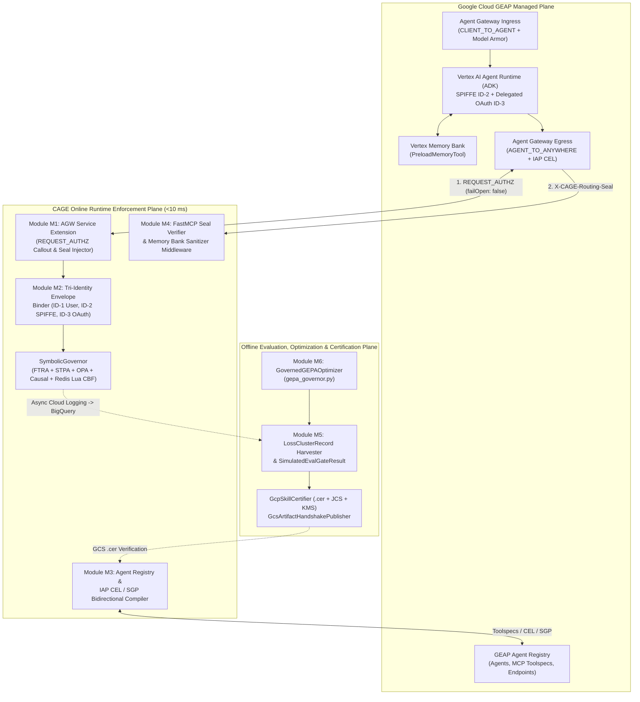

# CAGE × Gemini Enterprise Agent Platform (GEAP) Integration Architecture

**Document type:** Architectural Specification & Modular Implementation Blueprint  
**Status:** ACTIVE — Phases 1–3 (Modules M1–M6) Implemented at HEAD; Modules M7–M8 Specified  
**Date:** 2026-10-12  
**Last Updated:** 2026-10-22  
**Authority:** Supplements [`SUBSTRATE_MOAT_STRATEGY.md`](SUBSTRATE_MOAT_STRATEGY.md), [`GOVERNANCE_SUBSTRATE_DUALITY.md`](GOVERNANCE_SUBSTRATE_DUALITY.md), and [`EVALUATION_AND_ALIGNMENT_HARNESS.md`](EVALUATION_AND_ALIGNMENT_HARNESS.md)

---

## 1. Executive Summary & Architectural Thesis

The **Google Cloud Gemini Enterprise Agent Platform (GEAP)** provides managed capabilities across four lifecycle pillars:
1. **Build & Scale**: Google ADK (`LlmAgent`), Vertex AI Agent Engine (Agent Runtime), FastMCP tool servers on Cloud Run (`StreamableHTTP`), Vertex Memory Bank (`PreloadMemoryTool`), and A2A Agent Cards.
2. **Identity & Network Governance**: Agent Identity (`ID-1` User Identity, `ID-2` SPIFFE Agent Identity, `ID-3` OAuth Delegated Authority), Dual-Mode Agent Gateway (`CLIENT_TO_AGENT` ingress on Google Frontend and `AGENT_TO_ANYWHERE` egress on Secure Web Proxy), Agent Registry, and IAP egress policies (`roles/iap.egressor` + CEL + Semantic Governance Policies).
3. **Content Security**: Model Armor input/output screening templates and ADK guardrail callbacks (`before_model_callback`, `after_model_callback`).
4. **Evaluation, Telemetry & Optimization**: 3-Tier Evaluation Pipeline (`PointwiseMetric` rubrics, 10-minute Online Monitors over Cloud Trace → BigQuery, Simulated CI/CD Eval Gate), Failure Cluster Analysis (`generate_loss_clusters`), and the **Gemini Evolutionary Prompt Algorithm (`AgentOptimizer` / GEPA)**.

**CAGE** is a **cloud-agnostic, vendor-neutral governance engine** that can be deployed on any standard Kubernetes or container environment (`infra/targets/agnostic/`). **GEAP** (`infra/targets/gcp-gke/` with `advisor_runtime = "geap"`) is **one optional cloud deployment mode** where CAGE and GEAP operate at complementary, non-overlapping layers:
* **GEAP (Optional GCP Deployment Mode)** governs the **Network, Identity, and Probabilistic Platform Layer** (*who* the agent is, *which endpoints* it may reach, and *soft rubric / prompt screening*).
* **CAGE (Cloud-Agnostic Core)** governs the **Deterministic Consequence & Mathematical Invariant Substrate** (*what state mutations can physically commit* at the database/actuator boundary via [`ControlBarrierFunction.atomic_verify_and_commit`](../../src/gateway/governance/safety/cbf_engine.py), build-time STPA compilation in [`stpa_compiler.py`](../../src/gateway/governance/stpa_compiler.py), DoWhy causal refutation in [`gatekeeper.py`](../../src/gateway/governance/causal/gatekeeper.py) / [`world_model_refresher.py`](../../src/gateway/governance/causal/world_model_refresher.py), 4-state `DEFER` parking in [`defer_queue.py`](../../src/gateway/governance/defer_queue.py), KMS-signed routing seals in [`routing_seal.py`](../../src/gateway/governance/routing_seal.py), and Double-Ratchet calibrated evaluation in [`src/eval_harness/`](../../src/eval_harness/__init__.py)).

---

## 2. Gate G3 Layer Isolation Invariants

All GEAP integration modules strictly obey CAGE's Three-Layer Architecture and Split-Plane boundaries enforced by [`scripts/check_import_boundaries.py`](../../scripts/check_import_boundaries.py):

1. **Layer 1 Kernel ([`src/gateway/`](../../src/gateway/__init__.py))**: Strictly domain-agnostic and vendor-neutral. Never imports `google.cloud` SDKs or [`src/eval_harness/`](../../src/eval_harness/__init__.py).
2. **Layer 3 Integrations ([`src/integrations/`](../../src/integrations/__init__.py))**: Hosts all GCP and GEAP adapters, wire clients, and telemetry bridges.
3. **Offline Evaluation & Certification Plane ([`src/eval_harness/`](../../src/eval_harness/__init__.py) & [`src/integrations/gcp_eval/`](../../src/integrations/gcp_eval/__init__.py))**: Communicates with the `<10 ms` Online Enforcement Kernel strictly through immutable Cloud Storage `.cer` receipts ([`cer_publisher.py`](../../src/integrations/gcp_eval/cer_publisher.py)) and asynchronous BigQuery telemetry sinks ([`bq_harvester.py`](../../src/integrations/gcp_eval/bq_harvester.py)).

---

## 3. Complete 8-Module Architecture Overview

| Module | Name | Layer & Package Location | Status at HEAD |
|---|---|---|---|
| **M1** | **AGW `REQUEST_AUTHZ` Service Extension & Seal Injector** | Layer 1 Ingress ([`agw_adapter.py`](../../src/gateway/governance/ingress/agw_adapter.py)) | ✅ **Implemented (Phase 3)** |
| **M2** | **GEAP Tri-Identity (`ID-1`/`ID-2`/`ID-3`) Envelope Binder** | Layer 1 Seam ([`agw_adapter.py`](../../src/gateway/governance/ingress/agw_adapter.py), [`credential_broker.py`](../../src/gateway/governance/seams/credential_broker.py)) | ✅ **Implemented (Phase 3)** |
| **M3** | **Agent Registry Toolspec & IAP CEL / SGP Bidirectional Compiler** | Layer 1 Ingress ([`agent_registry_adapter.py`](../../src/gateway/governance/ingress/agent_registry_adapter.py), [`agp_policy_uploader.py`](../../src/gateway/governance/ingress/agp_policy_uploader.py), [`stpa_compiler.py`](../../src/gateway/governance/stpa_compiler.py)) | ✅ **Implemented (Phase 2)** |
| **M4** | **FastMCP Seal Verification Middleware & Memory Bank Guard** | Layer 3 GEAP Runtime ([`runtime_guards.py`](../../src/integrations/gcp_geap/runtime_guards.py)) + Layer 1 Seal ([`routing_seal.py`](../../src/gateway/governance/routing_seal.py), [`pii_sanitizer.py`](../../src/gateway/governance/pii_sanitizer.py)) | ✅ **Implemented (Phase 3)** |
| **M5** | **Failure Cluster Harvester & 3-Tier Simulated CI/CD Eval Gate** | Layer 3 GCP Eval ([`bq_harvester.py`](../../src/integrations/gcp_eval/bq_harvester.py), [`vertex_evaluator.py`](../../src/integrations/gcp_eval/vertex_evaluator.py)) | ✅ **Implemented (Phase 1)** |
| **M6** | **GEPA Evolutionary Prompt Governor (`GovernedGEPAOptimizer`)** | Layer 3 GCP Eval ([`gepa_governor.py`](../../src/integrations/gcp_eval/gepa_governor.py)) | ✅ **Implemented (Phase 1)** |
| **M7** | **OTel Cloud Trace & Sovereign Telemetry Bridge** | Layer 1 Telemetry Seam ([`telemetry_provider.py`](../../src/gateway/governance/telemetry_provider.py)) + Layer 3 Exporter | Phase 4 Specification |
| **M8** | **IaC (Terraform), Lula Validations & OSCAL Control Mapping** | [`infra/`](../../infra/targets/gcp-gke/main.tf), [`compliance/lula/`](../../compliance/lula/lula-validation-metrics.yaml), [`compliance/oscal/`](../../compliance/oscal/component-definition.yaml) | Phase 4 Specification |

---

## 4. Phase 1–3 Detailed Design: Modules M1–M6 (Implemented at HEAD)

### 4.1 Module M5: Failure Cluster Harvester & 3-Tier Simulated CI/CD Eval Gate

GEAP's 3-Tier Evaluation Pipeline combines manual `PointwiseMetric` rubrics, 10-minute Online Monitors over Cloud Trace → BigQuery, automated semantic failure clustering (`client.evals.generate_loss_clusters`), and a GitHub Actions Simulated Eval Gate (`score >= 3.0` on a 1.0–5.0 scale).

Module M5 closes two critical gaps in standalone LLM-as-a-judge evaluation pipelines:
1. **Closing the Failure Cluster → Golden Anchor Loop ([`BigQueryTrajectoryHarvester.harvest_loss_clusters_to_anchors`](../../src/integrations/gcp_eval/bq_harvester.py))**:
   * Ingests [`LossClusterRecord`](../../src/integrations/gcp_eval/bq_harvester.py) items either directly from a GEAP `evals_client.generate_loss_clusters(src=eval_result_name)` call or from a parameterized BigQuery loss-cluster table (`@skill_name`, `@max_avg_score`, `@row_limit`).
   * Scrubs all cluster titles, descriptions, prompts, and representative trajectories through [`PIISanitizer`](../../src/gateway/governance/pii_sanitizer.py).
   * Converts every representative failure trajectory (`avg_score < max_avg_score`) into a locked negative [`AnchorItem`](../../src/eval_harness/harness.py) (`golden_passed=False`) so subsequent offline evaluations calibrate against real production failure modes.
2. **Hardening the Simulated CI/CD PR Gate ([`VertexGenAIEvalBackend.run_simulated_cicd_gate`](../../src/integrations/gcp_eval/vertex_evaluator.py))**:
   * Returns a [`SimulatedEvalGateResult`](../../src/integrations/gcp_eval/vertex_evaluator.py) that requires all three conditions to hold simultaneously before a PR can merge:
     * **Condition A (Double Ratchet Calibration)**: [`VertexGenAIEvalBackend.calibrate_on_vertex_anchor_dataset`](../../src/integrations/gcp_eval/vertex_evaluator.py) must return `valid=True` (preventing vacuous always-pass judge drift).
     * **Condition B (GEAP 1–5 Rubric & 4-Bucket Skill Lift)**: `mean_rubric_score >= min_rubric_score` (default `3.0` on the 1.0–5.0 scale) and `mean_composite_lift >= min_composite_lift`.
     * **Condition C (Zero Eval-Prod Drift Invariants)**: Zero [`SymbolicGovernor`](../../src/gateway/governance/governor/governor.py) (`Profile.DRY_RUN`) denials and zero deterministic drawback triggers across all `with_skill` trajectories. Even if an LLM judge awards a `4.5 / 5.0` rubric score, a single STPA/OPA/CBF violation blocks the PR.

### 4.2 Module M6: GEPA Evolutionary Prompt Governor ([`src/integrations/gcp_eval/gepa_governor.py`](../../src/integrations/gcp_eval/gepa_governor.py)) & Standalone Reflective Optimizer ([`src/eval_harness/gepa_optimizer.py`](../../src/eval_harness/gepa_optimizer.py))

GEAP's **Gemini Evolutionary Prompt Algorithm (`AgentOptimizer` / GEPA)** evolves agent instructions across multiple generations (`generations=5, population_size=4`) optimizing `response_quality`, `tool_selection`, and `safety`. Without deterministic bounds, evolutionary mutation can strip compliance clauses, over-trigger tools on negative controls, or cause quadratic token bloat.

CAGE provides two complementary GEPA modules across its Split-Plane Architecture:
* **Standalone Reflective Evolution Engine ([`src/eval_harness/gepa_optimizer.py`](../../src/eval_harness/gepa_optimizer.py))**: Implements the open-source `gepa-ai/gepa` (Genetic-Pareto, `arXiv:2507.19457`) reflective text evolution loop (`CageGEPAAdapter`, `GEPAEvolutionEngine`, `ActionableSideInfo`, 4D `ParetoObjectives`, `PresidioPIIOptimizationEvaluator` for tuning Presidio/spaCy NER thresholds and allow-lists, and `run_gepa_optimize_anything()`) with zero cloud SDK dependencies.
* **Layer 3 GCP GEAP Population Governor ([`GovernedGEPAOptimizer`](../../src/integrations/gcp_eval/gepa_governor.py))**: Governs each [`GEPACandidateSpec`](../../src/integrations/gcp_eval/gepa_governor.py) produced across GEAP `AgentOptimizer` generations and emits a [`GEPAOptimizationReport`](../../src/integrations/gcp_eval/gepa_governor.py):
  1. **Stage 0 Static Linter Gate**: Evaluates mutated `SKILL.md` / instruction text via [`lint_skill_markdown`](../../src/eval_harness/static_linter.py) (enforcing `min_static_score` and `information_density_multiplier`).
  2. **Hard Invariant & Negative-Control Restraint Gate**: Replays candidate rollouts through [`FoundationModelEvalHarness.evaluate_paired_skill_lift`](../../src/eval_harness/harness.py). Any candidate with `dry_run_violations` or `negative_control_violations` is immediately pruned (`eliminated=True`, `fitness_score=0.0`).
  3. **Tokenomics & Quadratic Bloat Guard**: Runs [`compute_trajectory_tokenomics`](../../src/eval_harness/runner.py) across candidate rollouts and eliminates candidates exhibiting `is_quadratic_bloat` when `eliminate_on_quadratic_bloat=True`.
  4. **Composite Fitness & Automatic `.cer` Signing**: Ranks surviving candidates by a weighted combination of 4-bucket `mean_with_skill_composite`, `mean_composite_lift`, Stage 0 `length_adjusted_score`, normalized GEAP rubric scores, and `routing_premium`. When configured with a [`GcpSkillCertifier`](../../src/integrations/gcp_eval/cer_publisher.py), the winning survivor is automatically signed into a [`SkillCertificationReceipt`](../../src/eval_harness/harness.py) (`.cer`).

### 4.3 Module M3: Agent Registry Toolspec & IAP CEL / SGP Bidirectional Compiler

GEAP's **Agent Registry** catalogs three primary resource types (`Agents`, `MCP Servers`, and `Endpoints`), associates custom MCP `toolspecs` carrying `behavioralHints` (`readOnlyHint`, `destructiveHint`), and pairs with GEAP's 4-step `DRY_RUN` → `ENFORCED` Agent Gateway workflow using `roles/iap.egressor` IAM CEL conditions.

Module M3 bridges CAGE's STPA control structure and FTRA reachability engine with GEAP Agent Registry and IAM CEL policies:
1. **STPA → IAM CEL Egress Policy Compiler ([`generate_iap_cel_policies`](../../src/gateway/governance/stpa_compiler.py), `--targets iap-cel`)**:
   * Compiles STPA control action terminal classifications (`READ_ONLY` vs. mutating) and RBAC role memberships (`cs.rbac_rules.roles`) into deterministic GCP IAM CEL expressions (`resource.type == "networkservices" && destination.mcp.tool.name in [...]`) for `roles/iap.egressor` (`iap.webServiceVersions.egressViaIAP`).
2. **Three-Resource Agent Registry Sync & FTRA Override Derivation ([`RegistryCatalog`](../../src/gateway/governance/ingress/agent_registry_adapter.py), [`AgentRegistryAdapter`](../../src/gateway/governance/ingress/agent_registry_adapter.py))**:
   * Parses GEAP `agents` (supporting both `spiffe://` and `principal://agents.global.org-...` identities, A2A `skills`, and `toolSpecs`), `mcpServers` (`_parse_mcp_servers_response`), and `endpoints` (`_parse_endpoints_response`).
   * Exposes [`RegistryCatalog.to_ftra_terminal_overrides`](../../src/gateway/governance/ingress/agent_registry_adapter.py) to translate MCP `behavioralHints` (`destructiveHint=True` or `readOnlyHint=False` → `IRREVERSIBLE_TERMINAL`; `readOnlyHint=True` → `READ_ONLY`) into fail-closed FTRA terminal action overrides.
   * Implements [`AgentRegistryAdapter.associate_toolspec`](../../src/gateway/governance/ingress/agent_registry_adapter.py) to validate that every associated MCP tool declares explicit `behavioralHints` before registration.
3. **Fail-Closed `DRY_RUN` → `ENFORCED` Gateway Transition Gate ([`verify_and_transition_gateway_mode`](../../src/gateway/governance/ingress/agp_policy_uploader.py))**:
   * Returns a [`GatewayEnforcementTransitionResult`](../../src/gateway/governance/ingress/agp_policy_uploader.py) that blocks transitioning an Agent Gateway from `DRY_RUN` to `ENFORCED` unless: (a) every target observed in `discovered_targets` is registered in `RegistryCatalog`, (b) every target has an explicit `roles/iap.egressor` binding with a valid agent principal and non-empty CEL condition, and (c) all associated skill `.cer` artifacts are verified.

### 4.4 Modules M1 & M2: AGW `REQUEST_AUTHZ` Service Extension & Tri-Identity Envelope Binder

GEAP's **Agent Gateway (`AGENT_TO_ANYWHERE` egress mode)** intercepts outbound MCP tool calls on Secure Web Proxy and invokes an IAP `authzExtension` (`policyProfile: REQUEST_AUTHZ`, `action: CUSTOM`, `failOpen: false`) while propagating GEAP's Three-Identity model (`ID-1` end-user identity, `ID-2` Agent Runtime principal `principal://agents.global.org-...` or `spiffe://...`, and `ID-3` delegated OAuth 2.0 scope/token).

Modules M1 and M2 implement the online runtime callout and identity binding:
1. **Out-of-Band `kid`-Resolved OIDC Verification ([`AgwAdapter.validate_oidc_token`](../../src/gateway/governance/ingress/agw_adapter.py))**:
   * Enforces CAGE's Trust Anchor invariant: rejects any JWT header containing embedded keys (`jwk`, `x5c`, `x5u`, `jku`) or `none` algorithms, resolves public keys strictly by `kid` from `key_resolver` / `_jwks_cache`, and fails closed (`(False, {})`) on unknown `kid` or unconfigured issuer.
2. **GEAP Tri-Identity Context & PreCredentials Broker Seam ([`GeapTriIdentityContext`](../../src/gateway/governance/ingress/agw_adapter.py), [`TriIdentityCredentialBinding`](../../src/gateway/governance/seams/credential_broker.py))**:
   * [`AgwAdapter.extract_tri_identity`](../../src/gateway/governance/ingress/agw_adapter.py) binds `ID-1` (`user_id`), `ID-2` (`agent_principal`), and `ID-3` (`oauth_scopes` + SHA-256 digest of the delegated OAuth token — never persisting the raw token) into a deterministic RFC 8785 JCS digest (`compute_binding_digest()`).
   * `user_verified` is `True` only when `ID-1` comes from the `act_sub` / `user_sub` claim of a token verified by `validate_oidc_token`. An `ID-1` taken from the request payload or the `x-geap-user-id` header is caller-asserted (`user_verified=False`). `to_envelope_claims()` records the flag as `id1_user_verified`; the binding digest does not cover it. `ID-1` is attribution only (see the advisor's [Principal Trust Model](../examples/governed-financial-advisor/ARCHITECTURE.md#45-principal-trust-model)).
   * [`validate_tri_identity_binding`](../../src/gateway/governance/seams/credential_broker.py) enforces that `ID-3` outbound credential release is gated on a valid `ID-2` principal, `ID-1` user delegation, and a non-empty `PreCredentials` `X-CAGE-Routing-Seal`.
3. **MCP JSON-RPC 2.0 `tools/call` Callout & Seal Injection ([`AgwAdapter.evaluate_request_authz`](../../src/gateway/governance/ingress/agw_adapter.py))**:
   * Normalizes decoded MCP JSON-RPC 2.0 `tools/call` payloads (`params.name`, `params.arguments`), enforces `failOpen: false`, evaluates `governor.validate_action(tool_name, governed_params)`, and returns [`AgwRequestAuthzDecision`](../../src/gateway/governance/ingress/agw_adapter.py) injecting `X-CAGE-Routing-Seal` and `X-CAGE-Tri-Identity-Digest` on `ALLOW` (`HTTP 200`) or failing closed on `DENY` / `DEFER` / `UNAUTHENTICATED` (`HTTP 403`).

### 4.5 Module M4: FastMCP Seal Verification Middleware & ADK Memory Bank Guard ([`src/integrations/gcp_geap/runtime_guards.py`](../../src/integrations/gcp_geap/runtime_guards.py))

1. **FastMCP Seal Verification Middleware ([`FastMcpSealVerificationMiddleware`](../../src/integrations/gcp_geap/runtime_guards.py))**:
   * Enforces ADR-009 tiered actuation on Cloud Run FastMCP (`StreamableHTTP`) servers: read-only MCP methods (`tools/list`, `resources/list`, `prompts/list`, and configured `read_only_tools`) pass through when `require_seal_for_read_only=False`, whereas mutating tools require `X-CAGE-Routing-Seal` and pass [`verify_and_consume_seal`](../../src/gateway/governance/routing_seal.py) (or [`verify_seal`](../../src/gateway/governance/routing_seal.py)) plus constant-time `X-CAGE-Tri-Identity-Digest` verification.
2. **ADK Vertex Memory Bank Guard ([`GovernedMemoryBankGuard`](../../src/integrations/gcp_geap/runtime_guards.py))**:
   * `guard_save_session_to_memory()` scans all session events via [`detect_prompt_injection`](../../src/gateway/governance/prompt_injection_detector.py) — failing closed and skipping `ctx.add_session_to_memory()` if any event contains a prompt injection payload — and scrubs all PII via [`PIISanitizer`](../../src/gateway/governance/pii_sanitizer.py) prior to persistence.
   * `guard_preloaded_memories()` filters or blocks poisoned memories returned by `PreloadMemoryTool` (`before_model_callback`) and redacts PII before prompt injection.

### 4.6 Governed Financial Advisor on GEAP Agent Runtime (Optional GCP Deployment Mode)

For the optional `gcp-gke` deployment mode ([`infra/targets/gcp-gke/main.tf`](../../infra/targets/gcp-gke/main.tf), `advisor_runtime = "geap"` by default; `agnostic` target deployments and `advisor_runtime = "gke"` continue using the cloud-agnostic Kubernetes module [`infra/modules/governed_advisor/main.tf`](../../infra/modules/governed_advisor/main.tf)), the **Governed Financial Advisor** orchestration layer runs on **GEAP Agent Runtime (Vertex AI Agent Engine)** via [`GovernedFinancialAdvisorGeapApp`](../../src/governed_financial_advisor/geap_app.py) and [`infra/modules/gcp_geap_advisor/main.tf`](../../infra/modules/gcp_geap_advisor/main.tf), while the CAGE Hybrid Gateway, OPA, vLLM GPU pools, Reconciliation Worker, and Compliance Bridge run on GKE:
1. **Zero Advisor Signing Authority (`POAM-2026-079`)**: [`GovernedFinancialAdvisorGeapApp.set_up`](../../src/governed_financial_advisor/geap_app.py) invokes [`assert_no_signing_identity`](../../src/governed_financial_advisor/infrastructure/identity_guard.py) before initializing the LangGraph state machine and forces `LANGSMITH_TRACING="false"` and `LANGCHAIN_TRACING_V2="false"`.
2. **Two-Layer Ingress Identity Verification (`POAM-2026-080`)**: [`WorkloadIdentityMiddleware`](../../src/gateway/server/workload_identity.py) enforces both Linkerd mTLS (`CAGE_TRUSTED_CLIENT_IDENTITIES`) and `kid`-resolved GEAP `ID-2` OIDC Bearer JWT verification (`CAGE_TRUSTED_GEAP_AGENT_PRINCIPALS`) via [`AgwAdapter.validate_oidc_token`](../../src/gateway/governance/ingress/agw_adapter.py). [`GatewayClient._build_headers`](../../src/governed_financial_advisor/infrastructure/gateway_client.py) injects `Authorization: Bearer <id2_token>` and `x-geap-user-id` (`ID-1`), the caller-asserted end-user principal, sanitized and capped at 64 characters exactly like `x-cage-principal`.
3. **Direct VPC Egress (`SC-7`) & Regional Sovereignty (`DEP-10`)**: [`infra/modules/gcp_geap_advisor/main.tf`](../../infra/modules/gcp_geap_advisor/main.tf) enforces `vpc_egress_setting = "ALL_TRAFFIC"` into the GKE VPC (`var.network` / `var.subnetwork`), regional CMEK encryption (`var.kms_key_name`), and a `DEP-10` lifecycle precondition restricting deployment to approved sovereign regions (`us-central1`, `europe-west1`, `asia-southeast1`).
4. **Split-Plane Process Isolation (`SC-39` — Optional GEAP MicroVM Mode vs. Cloud-Agnostic / GKE Runtime)**: While cloud-agnostic deployments (`infra/targets/agnostic/`) enforce `SC-39` via universal Kubernetes Pod Security Standards (`restricted`) and non-root `securityContext`, the optional `gcp-gke` + `advisor_runtime = "geap"` mode inherits hardware-enforced **MicroVM isolation** natively from GEAP Agent Runtime (Agent Substrate) without provisioning `runtimeClassName: microvm` nested-virtualization pods on GKE. This allows the GKE cluster ([`infra/modules/gcp_gke_cluster/main.tf`](../../infra/modules/gcp_gke_cluster/main.tf)) to keep `gpu-l4` (`g2-standard-8` NVIDIA L4) and `clickhouse` (Local NVMe SSD) pools on native container runtime (`runc`) for direct PCIe/NVMe hardware access, while keeping stateless governance control-plane pods (`gateway`, `opa`, `compliance-bridge`, `reconciliation-worker`) on cost-efficient `E2` nodes enforced by Pod Security Standards (`restricted`) and optional `gvisor` (`enable_gvisor_sandbox`) user-space kernel sandboxing.

---

## 5. Phase 4 Modular Specifications (Future Work Packages)

### 5.1 Modules M7 & M8: OTel Cloud Trace Bridge, IaC, Lula & OSCAL
* **GEAP Integration Seam**: OpenTelemetry GenAI spans exported to Cloud Trace and BigQuery; Terraform and compliance assertions for Agent Gateway and Model Armor.
* **CAGE Target**: Inject `cage.receipt_digest` and `cage.deployment_region` into OTel spans via [`telemetry_provider.py`](../../src/gateway/governance/telemetry_provider.py) (keeping `LANGSMITH_TRACING=false`), add Lula validations under `compliance/lula/`, and export updated NIST SP 800-53 mappings via [`oscal_ssp_exporter.py`](../../src/gateway/governance/oscal_ssp_exporter.py).
