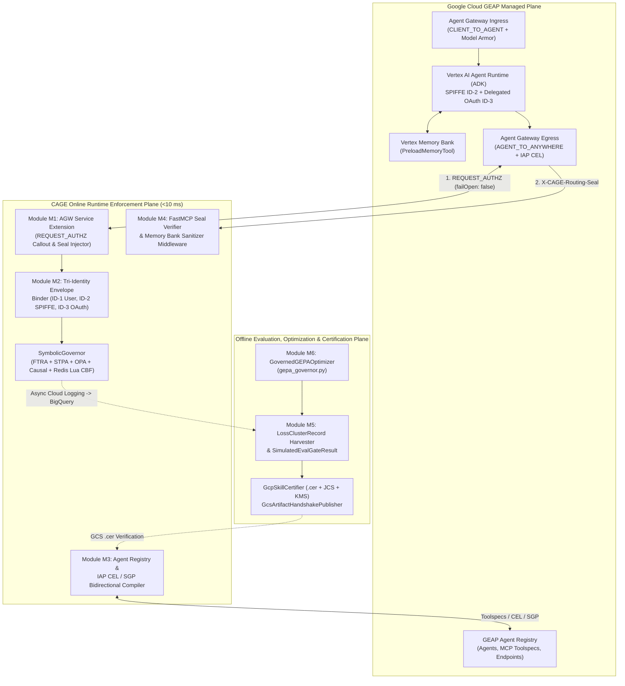

# CAGE × Gemini Enterprise Agent Platform (GEAP) Integration Architecture

**Document type:** Architectural Specification & Modular Implementation Blueprint  
**Status:** ACTIVE — Phase 1 (Modules M5 & M6) Implemented at HEAD; Modules M1–M4, M7–M8 Specified  
**Date:** 2026-10-12  
**Authority:** Supplements [`SUBSTRATE_MOAT_STRATEGY.md`](SUBSTRATE_MOAT_STRATEGY.md), [`GOVERNANCE_SUBSTRATE_DUALITY.md`](GOVERNANCE_SUBSTRATE_DUALITY.md), and [`EVALUATION_AND_ALIGNMENT_HARNESS.md`](EVALUATION_AND_ALIGNMENT_HARNESS.md)

---

## 1. Executive Summary & Architectural Thesis

The **Google Cloud Gemini Enterprise Agent Platform (GEAP)** provides managed capabilities across four lifecycle pillars:
1. **Build & Scale**: Google ADK (`LlmAgent`), Vertex AI Agent Engine (Agent Runtime), FastMCP tool servers on Cloud Run (`StreamableHTTP`), Vertex Memory Bank (`PreloadMemoryTool`), and A2A Agent Cards.
2. **Identity & Network Governance**: Agent Identity (`ID-1` User Identity, `ID-2` SPIFFE Agent Identity, `ID-3` OAuth Delegated Authority), Dual-Mode Agent Gateway (`CLIENT_TO_AGENT` ingress on Google Frontend and `AGENT_TO_ANYWHERE` egress on Secure Web Proxy), Agent Registry, and IAP egress policies (`roles/iap.egressor` + CEL + Semantic Governance Policies).
3. **Content Security**: Model Armor input/output screening templates and ADK guardrail callbacks (`before_model_callback`, `after_model_callback`).
4. **Evaluation, Telemetry & Optimization**: 3-Tier Evaluation Pipeline (`PointwiseMetric` rubrics, 10-minute Online Monitors over Cloud Trace → BigQuery, Simulated CI/CD Eval Gate), Failure Cluster Analysis (`generate_loss_clusters`), and the **Gemini Evolutionary Prompt Algorithm (`AgentOptimizer` / GEPA)**.

**CAGE** and **GEAP** operate at complementary, non-overlapping layers:
* **GEAP** governs the **Network, Identity, and Probabilistic Platform Layer** (*who* the agent is, *which endpoints* it may reach, and *soft rubric / prompt screening*).
* **CAGE** governs the **Deterministic Consequence & Mathematical Invariant Substrate** (*what state mutations can physically commit* at the database/actuator boundary via [`ControlBarrierFunction.atomic_verify_and_commit`](../../src/gateway/governance/safety/cbf_engine.py), build-time STPA compilation in [`stpa_compiler.py`](../../src/gateway/governance/stpa_compiler.py), DoWhy causal refutation in [`gatekeeper.py`](../../src/gateway/governance/causal/gatekeeper.py), 4-state `DEFER` parking in [`defer_queue.py`](../../src/gateway/governance/defer_queue.py), KMS-signed routing seals in [`routing_seal.py`](../../src/gateway/governance/routing_seal.py), and Double-Ratchet calibrated evaluation in [`src/eval_harness/`](../../src/eval_harness/__init__.py)).

---

## 2. Gate G3 Layer Isolation Invariants

All GEAP integration modules strictly obey CAGE's Three-Layer Architecture and Split-Plane boundaries enforced by [`scripts/check_import_boundaries.py`](../../scripts/check_import_boundaries.py):

1. **Layer 1 Kernel ([`src/gateway/`](../../src/gateway/__init__.py))**: Strictly domain-agnostic and vendor-neutral. Never imports `google.cloud` SDKs or [`src/eval_harness/`](../../src/eval_harness/__init__.py).
2. **Layer 3 Integrations ([`src/integrations/`](../../src/integrations/__init__.py))**: Hosts all GCP and GEAP adapters, wire clients, and telemetry bridges.
3. **Offline Evaluation & Certification Plane ([`src/eval_harness/`](../../src/eval_harness/__init__.py) & [`src/integrations/gcp_eval/`](../../src/integrations/gcp_eval/__init__.py))**: Communicates with the `<10 ms` Online Enforcement Kernel strictly through immutable Cloud Storage `.cer` receipts ([`cer_publisher.py`](../../src/integrations/gcp_eval/cer_publisher.py)) and asynchronous BigQuery telemetry sinks ([`bq_harvester.py`](../../src/integrations/gcp_eval/bq_harvester.py)).

---

## 3. Complete 8-Module Architecture Overview

| Module | Name | Layer & Package Location | Status at HEAD |
|---|---|---|---|
| **M1** | **AGW `REQUEST_AUTHZ` Service Extension & Seal Injector** | Layer 1 Ingress ([`agw_adapter.py`](../../src/gateway/governance/ingress/agw_adapter.py)) + Layer 3 Adapter | Phase 3 Specification |
| **M2** | **GEAP Tri-Identity (`ID-1`/`ID-2`/`ID-3`) Envelope Binder** | Layer 1 Seam ([`workload_identity.py`](../../src/gateway/server/workload_identity.py), [`credential_broker.py`](../../src/gateway/governance/seams/credential_broker.py)) | Phase 3 Specification |
| **M3** | **Agent Registry Toolspec & IAP CEL / SGP Bidirectional Compiler** | Layer 1 Ingress ([`agent_registry_adapter.py`](../../src/gateway/governance/ingress/agent_registry_adapter.py), [`agp_policy_uploader.py`](../../src/gateway/governance/ingress/agp_policy_uploader.py)) | Phase 2 Specification (Base adapters shipped) |
| **M4** | **FastMCP Seal Verification Middleware & Memory Bank Guard** | Layer 1 Seal ([`routing_seal.py`](../../src/gateway/governance/routing_seal.py), [`pii_sanitizer.py`](../../src/gateway/governance/pii_sanitizer.py)) + Layer 3 ADK Middleware | Phase 3 Specification |
| **M5** | **Failure Cluster Harvester & 3-Tier Simulated CI/CD Eval Gate** | Layer 3 GCP Eval ([`bq_harvester.py`](../../src/integrations/gcp_eval/bq_harvester.py), [`vertex_evaluator.py`](../../src/integrations/gcp_eval/vertex_evaluator.py)) | ✅ **Implemented (Phase 1)** |
| **M6** | **GEPA Evolutionary Prompt Governor (`GovernedGEPAOptimizer`)** | Layer 3 GCP Eval ([`gepa_governor.py`](../../src/integrations/gcp_eval/gepa_governor.py)) | ✅ **Implemented (Phase 1)** |
| **M7** | **OTel Cloud Trace & Sovereign Telemetry Bridge** | Layer 1 Telemetry Seam ([`telemetry_provider.py`](../../src/gateway/governance/telemetry_provider.py)) + Layer 3 Exporter | Phase 4 Specification |
| **M8** | **IaC (Terraform), Lula Validations & OSCAL Control Mapping** | [`infra/`](../../infra/targets/gcp-gke/main.tf), [`compliance/lula/`](../../compliance/lula/lula-validation-metrics.yaml), [`compliance/oscal/`](../../compliance/oscal/component-definition.yaml) | Phase 4 Specification |

---

## 4. Phase 1 Detailed Design: Modules M5 & M6 (Implemented at HEAD)

### 4.1 Module M5: Failure Cluster Harvester & 3-Tier Simulated CI/CD Eval Gate

GEAP's 3-Tier Evaluation Pipeline combines manual `PointwiseMetric` rubrics, 10-minute Online Monitors over Cloud Trace → BigQuery, automated semantic failure clustering (`client.evals.generate_loss_clusters`), and a GitHub Actions Simulated Eval Gate (`score >= 3.0` on a 1.0–5.0 scale).

Module M5 closes two critical gaps in standalone LLM-as-a-judge evaluation pipelines:
1. **Closing the Failure Cluster → Golden Anchor Loop ([`BigQueryTrajectoryHarvester.harvest_loss_clusters_to_anchors`](../../src/integrations/gcp_eval/bq_harvester.py))**:
   * Ingests [`LossClusterRecord`](../../src/integrations/gcp_eval/bq_harvester.py) items either directly from a GEAP `evals_client.generate_loss_clusters(src=eval_result_name)` call or from a parameterized BigQuery loss-cluster table (`@skill_name`, `@max_avg_score`, `@row_limit`).
   * Scrubs all cluster titles, descriptions, prompts, and representative trajectories through [`PIISanitizer`](../../src/gateway/governance/pii_sanitizer.py).
   * Converts every representative failure trajectory (`avg_score < max_avg_score`) into a locked negative [`AnchorItem`](../../src/eval_harness/harness.py) (`golden_passed=False`) so subsequent offline evaluations calibrate against real production failure modes.
2. **Hardening the Simulated CI/CD PR Gate ([`VertexGenAIEvalBackend.run_simulated_cicd_gate`](../../src/integrations/gcp_eval/vertex_evaluator.py))**:
   * Returns a [`SimulatedEvalGateResult`](../../src/integrations/gcp_eval/vertex_evaluator.py) that requires all three conditions to hold simultaneously before a PR can merge:
     * **Condition A (Double Ratchet Calibration)**: [`VertexGenAIEvalBackend.calibrate_on_vertex_anchor_dataset`](../../src/integrations/gcp_eval/vertex_evaluator.py) must return `valid=True` (preventing vacuous always-pass judge drift).
     * **Condition B (GEAP 1–5 Rubric & 4-Bucket Skill Lift)**: `mean_rubric_score >= min_rubric_score` (default `3.0` on the 1.0–5.0 scale) and `mean_composite_lift >= min_composite_lift`.
     * **Condition C (Zero Eval-Prod Drift Invariants)**: Zero [`SymbolicGovernor`](../../src/gateway/governance/governor/governor.py) (`Profile.DRY_RUN`) denials and zero deterministic drawback triggers across all `with_skill` trajectories. Even if an LLM judge awards a `4.5 / 5.0` rubric score, a single STPA/OPA/CBF violation blocks the PR.

### 4.2 Module M6: GEPA Evolutionary Prompt Governor ([`src/integrations/gcp_eval/gepa_governor.py`](../../src/integrations/gcp_eval/gepa_governor.py))

GEAP's **Gemini Evolutionary Prompt Algorithm (`AgentOptimizer` / GEPA)** evolves agent instructions across multiple generations (`generations=5, population_size=4`) optimizing `response_quality`, `tool_selection`, and `safety`. Without deterministic bounds, evolutionary mutation can strip compliance clauses, over-trigger tools on negative controls, or cause quadratic token bloat.

[`GovernedGEPAOptimizer`](../../src/integrations/gcp_eval/gepa_governor.py) governs each [`GEPACandidateSpec`](../../src/integrations/gcp_eval/gepa_governor.py) across generations and emits a [`GEPAOptimizationReport`](../../src/integrations/gcp_eval/gepa_governor.py):
1. **Stage 0 Static Linter Gate**: Evaluates mutated `SKILL.md` / instruction text via [`lint_skill_markdown`](../../src/eval_harness/static_linter.py) (enforcing `min_static_score` and `information_density_multiplier`).
2. **Hard Invariant & Negative-Control Restraint Gate**: Replays candidate rollouts through [`FoundationModelEvalHarness.evaluate_paired_skill_lift`](../../src/eval_harness/harness.py). Any candidate with `dry_run_violations` or `negative_control_violations` is immediately pruned (`eliminated=True`, `fitness_score=0.0`).
3. **Tokenomics & Quadratic Bloat Guard**: Runs [`compute_trajectory_tokenomics`](../../src/eval_harness/runner.py) across candidate rollouts and eliminates candidates exhibiting `is_quadratic_bloat` when `eliminate_on_quadratic_bloat=True`.
4. **Composite Fitness & Automatic `.cer` Signing**: Ranks surviving candidates by a weighted combination of 4-bucket `mean_with_skill_composite`, `mean_composite_lift`, Stage 0 `length_adjusted_score`, normalized GEAP rubric scores, and `routing_premium`. When configured with a [`GcpSkillCertifier`](../../src/integrations/gcp_eval/cer_publisher.py), the winning survivor is automatically signed into a [`SkillCertificationReceipt`](../../src/eval_harness/harness.py) (`.cer`).

---

## 5. Phase 2–4 Modular Specifications (Future Work Packages)

### 5.1 Module M1: AGW `REQUEST_AUTHZ` Service Extension & Seal Injector
* **GEAP Integration Seam**: Agent Gateway in `AGENT_TO_ANYWHERE` (egress) mode configured with `policyProfile: REQUEST_AUTHZ`, `action: CUSTOM`, `failOpen: false`.
* **CAGE Target**: Extend [`AgwAdapter`](../../src/gateway/governance/ingress/agw_adapter.py) and [`hybrid_server.py`](../../src/gateway/server/hybrid_server.py) to parse decoded MCP JSON-RPC 2.0 tool invocations (`tools/call`), execute [`SymbolicGovernor.validate_action`](../../src/gateway/governance/governor/governor.py), and return `X-CAGE-Routing-Seal` minted via [`routing_seal.py`](../../src/gateway/governance/routing_seal.py).

### 5.2 Module M2: GEAP Tri-Identity (`ID-1`/`ID-2`/`ID-3`) Envelope Binder
* **GEAP Integration Seam**: `ID-1` (end-user identity), `ID-2` (Agent Runtime SPIFFE principal `principal://agents.global.org-.../reasoningEngines/...`), and `ID-3` (OAuth 2.0 user-delegated token).
* **CAGE Target**: Extend [`AgwAdapter.validate_oidc_token`](../../src/gateway/governance/ingress/agw_adapter.py) using out-of-band `kid` resolution ([`Ed25519KeyManifestClient`](../../src/integrations/trust/key_manifest.py)) and bind all three identity claims into [`GovernanceEnvelopeBuilder`](../../src/gateway/governance/governance_envelope.py) and [`credential_broker.py`](../../src/gateway/governance/seams/credential_broker.py) while preserving [`WorkloadIdentityMiddleware`](../../src/gateway/server/workload_identity.py).

### 5.3 Module M3: Agent Registry Toolspec & IAP CEL / SGP Bidirectional Compiler
* **GEAP Integration Seam**: Agent Registry catalog (`agents`, `mcp-servers`, `endpoints`, `toolspecs associate`) and the 4-step `DRY_RUN` → `ENFORCED` workflow with `roles/iap.egressor` CEL conditions and Semantic Governance Policies (SGP).
* **CAGE Target**: Extend [`AgentRegistryAdapter`](../../src/gateway/governance/ingress/agent_registry_adapter.py) to sync MCP toolspecs into [`src/gateway/governance/ftra/`](../../src/gateway/governance/ftra/__init__.py); extend [`stpa_compiler.py`](../../src/gateway/governance/stpa_compiler.py) and [`upload_agp_policy`](../../src/gateway/governance/ingress/agp_policy_uploader.py) to emit IAM CEL conditions alongside SGPs, and require `.cer` verification via [`GcsSkillCertificationVerifier`](../../src/integrations/gcp_eval/cer_publisher.py) before transitioning to `ENFORCED`.

### 5.4 Module M4: FastMCP Seal Verification Middleware & ADK Memory Bank Guard
* **GEAP Integration Seam**: Cloud Run FastMCP tool servers (`StreamableHTTP`), Vertex Memory Bank (`PreloadMemoryTool`, `save_memories_callback`), and ADK model callbacks (`before_model_callback`, `after_model_callback`).
* **CAGE Target**: Provide a Layer 3 FastMCP middleware invoking [`verify_and_consume_seal`](../../src/gateway/governance/routing_seal.py) on mutating tool calls, and a Memory Bank callback wrapper applying [`PIISanitizer`](../../src/gateway/governance/pii_sanitizer.py) and prompt-injection checks ([`prompt_injection_detector.py`](../../src/gateway/governance/prompt_injection_detector.py)) before `ctx.add_session_to_memory()`.

### 5.5 Modules M7 & M8: OTel Cloud Trace Bridge, IaC, Lula & OSCAL
* **GEAP Integration Seam**: OpenTelemetry GenAI spans exported to Cloud Trace and BigQuery; Terraform and compliance assertions for Agent Gateway and Model Armor.
* **CAGE Target**: Inject `cage.receipt_digest` and `cage.deployment_region` into OTel spans via [`telemetry_provider.py`](../../src/gateway/governance/telemetry_provider.py) (keeping `LANGSMITH_TRACING=false`), add Lula validations under `compliance/lula/`, and export updated NIST SP 800-53 mappings via [`oscal_ssp_exporter.py`](../../src/gateway/governance/oscal_ssp_exporter.py).
