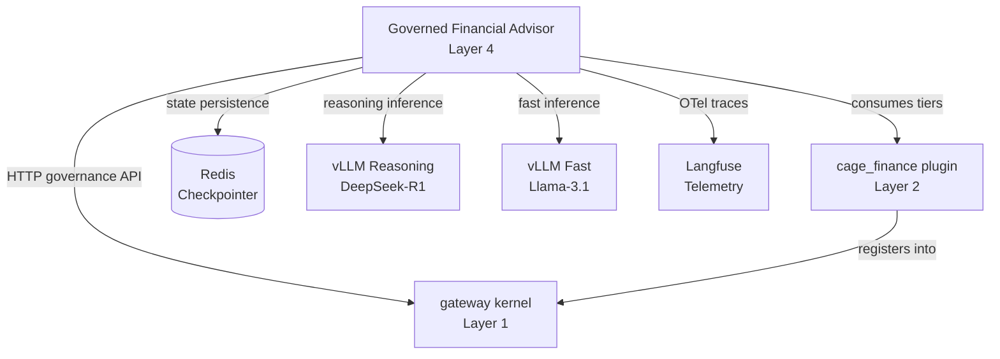

# Governed Financial Advisor — Reference Application Architecture

> **Classification**: Layer 4 Reference Application (Optional)  
> **Location**: `src/governed_financial_advisor/`  
> **Purpose**: Demonstrates the CAGE governance kernel applied to an autonomous multi-agent wealth advisory workflow  
> **Status**: Example reference implementation — strictly decoupled from Layer 1 core operations

**Version:** v3.0.1  
**Domain Plugin Dependency:** [`src/cage_finance/`](../../../src/cage_finance/) (Layer 2)  
**Kernel Dependency:** [`src/gateway/`](../../../src/gateway/) (Layer 1)

---

## Table of Contents

1. [Overview & Separation of Concerns](#1-overview--separation-of-concerns)
2. [Multi-Agent Architecture](#2-multi-agent-architecture)
3. [LangGraph Governance Harness Integration](#3-langgraph-governance-harness-integration)
4. [Application Endpoints & API Surface](#4-application-endpoints--api-surface)
5. [Deployment & Operational Topology](#5-deployment--operational-topology)

---

## 1. Overview & Separation of Concerns

### 1.1 Architectural Role

The Governed Financial Advisor (GFA) is a **Layer 4 reference application** that demonstrates how domain-specific agentic workflows integrate with the CAGE Layer 1 governance kernel. It is **not** a required component of the CAGE platform — the kernel is domain-agnostic and can govern healthcare, manufacturing, logistics, or any other vertical with equal fidelity.

### 1.2 Domain Isolation & Replaceable Plugin Architecture

The GFA implements a **multi-agent wealth advisory workflow** using:
- **LangGraph StateGraph**: 12-node orchestration graph with typed state transitions
- **Specialist Sub-Agents**: Market data analyst, risk analyst, execution analyst, evaluator, explainer, and governed trader
- **Split-Brain Model Routing**: Strategic reasoning (DeepSeek-R1) + rapid execution (Llama-3.1)
- **Domain Plugin Injection**: Consumes [`src/cage_finance/`](../../../src/cage_finance/) tiers (CBF fiscal bounds, bounding contracts, trade ontology) via `SymbolicGovernor(domain_tiers=[...])`

### 1.3 Non-Dependence of Layer 1 on Layer 4

The Layer 1 kernel ([`src/gateway/`](../../../src/gateway/)) has **zero awareness** of the GFA application. The governance substrate provides:
- Universal dispatch loop ([`src/gateway/governance/governor/governor.py`](../../../src/gateway/governance/governor/governor.py))
- FTRA reachability analysis ([`src/gateway/governance/ftra/`](../../../src/gateway/governance/ftra/))
- Consequence Gateway atomic verification ([`consequence_gateway.py`](../../../src/gateway/governance/consequence_gateway.py))
- Evidence accumulation ([`evidence/stream.py`](../../../src/gateway/governance/evidence/stream.py); not [`provenance_chain.py`](../../../src/gateway/governance/provenance_chain.py), an unwired library with no production caller, `POAM-2026-246`)

The GFA **consumes** these primitives via HTTP endpoints and LangGraph node factories, but the kernel does not import from, call into, or depend on the GFA codebase. This strict boundary is enforced by Gate G3 ([`scripts/check_import_boundaries.py`](../../../scripts/check_import_boundaries.py)).

---

## 2. Multi-Agent Architecture

### 2.1 Agent Roles & Interaction Topology

The GFA orchestrates **9 specialist agents** in a LangGraph `StateGraph` ([`src/governed_financial_advisor/graph/graph.py`](../../../src/governed_financial_advisor/graph/graph.py)):

| Agent | Role | Model | Output |
|---|---|---|---|
| **Thinker Node** | Strategic reasoning | `DeepSeek-R1-Distill-Llama-8B` | `reasoning_output` |
| **Doer Node** | Instruction decomposition | `MODEL_FAST` (Llama-3.1) | Decomposed instructions |
| **Data Analyst** | Market data fetch | yfinance (no LLM) | `data_analyst_ticker`, price history, top 3 news |
| **Execution Analyst** | Structured plan synthesis | `MODEL_REASONING` + guided JSON | `ExecutionPlan` (list of `PlanStep`) |
| **Evaluator** | Audit verification | `Qwen/Qwen2.5-1.5B-Instruct` | `evaluation_result`, `opa_results`, `governance_signature` |
| **Risk Analyst** | STPA/UCA hazard analysis | STAMP hazards from GCS | `ProposedUCA` structs |
| **Governed Trader** | Final trade execution | `MODEL_FAST` | `execution_result` |
| **Explainer** | Compliance narrative | `MODEL_FAST` | Human-readable audit summary |
| **Financial Advisor** | Framing prompt | `MODEL_REASONING` | Advisory context |

### 2.2 Split-Brain Model Routing

The GFA leverages a **dual-pool inference topology**:
- **Reasoning Pool** (`vllm-reasoning`): Deep planning, multi-step analysis, chain-of-thought (DeepSeek-R1)
- **Governance Pool** (`vllm-inference`): Rapid policy checks, tool-calling execution, content moderation (Llama-3.1, Qwen-2.5)

Routing is transparent to agents — the `ConfigManager` ([`src/governed_financial_advisor/infrastructure/llm/config.py`](../../../src/governed_financial_advisor/infrastructure/llm/config.py)) resolves `MODEL_REASONING` and `MODEL_FAST` endpoints from environment variables.

### 2.3 Shared State Contract

All graph nodes share a single `AgentState` TypedDict ([`src/governed_financial_advisor/graph/state.py`](../../../src/governed_financial_advisor/graph/state.py)) with **33 fields**:

| Field Category | Example Fields |
|---|---|
| **User Input** | `user_query`, `user_id`, `thread_id` |
| **Agent Outputs** | `reasoning_output`, `doer_output`, `execution_plan_output`, `evaluation_result`, `execution_result` |
| **Governance Signals** | `guardrail_blocked`, `opa_results`, `governance_signature`, `safety_status` |
| **FTRA & DEFER** | `ftra_status`, `ftra_result`, `ftra_defer_id`, `defer_resume_token` |
| **HITL Approval** | `approval_required`, `approval_granted`, `approval_decision` |
| **Audit Trail** | `completed_transactions`, `uca_violations` |

This contract is enforced by JSON Schema validation ([`compliance/schemas/agent_state_schema.json`](../../../compliance/schemas/agent_state_schema.json)) with CI drift detection ([`tests/test_agent_state_schema.py`](../../../tests/test_agent_state_schema.py)). **Note:** Schema enforcement is specified in [`AGENT_STATE_SCHEMA_ENFORCEMENT.md`](../../architecture/AGENT_STATE_SCHEMA_ENFORCEMENT.md) (GAP-3 design specification, pending implementation).

---

## 3. LangGraph Governance Harness Integration

### 3.1 Pre-Action Interception via Node Factories

The GFA injects governance checks as **first-class LangGraph nodes** using the LangGraph Harness ([`src/gateway/governance/langgraph_harness/`](../../../src/gateway/governance/langgraph_harness/)):

| Governance Node | Factory Function | Integration Point |
|---|---|---|
| **NeMo Input Rail** | `create_nemo_input_node()` | `guardrail_node.py` — pre-thinker mandatory rail |
| **NeMo Output Rail** | `create_nemo_output_node()` | `guardrail_node.py` — post-explainer mandatory rail |
| **OPA Safety Check** | `create_opa_safety_node()` | `safety_node.py` — pre-trader policy gate |
| **FTRA Reachability** | `create_ftra_node()` | `graph.py` — post-evaluator irreversibility check |

### 3.2 Consequence Token Validation

The advisor is an untrusted client of the governance gateway and holds no signing key (POAM-2026-079). The evaluator edge [`route_after_evaluator()`](../../../src/governed_financial_advisor/graph/graph.py) routes on the evaluator's `APPROVED` verdict alone. Authorization is enforced on the gateway side instead:

- The trader's `execute_trade_action` MCP tool ([`tool_provider.py`](../../../src/cage_finance/tools/tool_provider.py)) runs the full governor, mints a routing seal, and has the `ActuatorRegistry` verify and consume that seal before dispatch.
- The gateway, not the advisor, decides whether a trade needs a human: [`gateway_tool_guard`](../../../src/governed_financial_advisor/graph/governance/tool_guard.py) parks a `REQUIRE_APPROVAL` verdict's `deferred_id` and routes to the approval interrupt. After approval (recorded in the gateway's DeferQueue via the compliance bridge `POST /v1/defer/{defer_id}/escalate`), [`post_hitl_revalidate_node()`](../../../src/governed_financial_advisor/graph/subgraphs/governed_trader_graph.py) applies only the reviewer's slippage gate; `execute_trade_action(deferred_id=...)` then consumes the approval once and re-validates the fresh params in the gateway (see [`docs/security/HITL_TOCTOU_REMEDIATION.md`](../../../docs/security/HITL_TOCTOU_REMEDIATION.md)).

The advisor's startup guard ([`identity_guard.py`](../../../src/governed_financial_advisor/infrastructure/identity_guard.py)) refuses to boot if any signing-key variable is present in its environment.

### 3.3 LangGraph HITL Interrupt Point

The graph compiles with a gateway-mediated checkpointer ([`graph.py:create_graph()`](../../../src/governed_financial_advisor/graph/graph.py)), and [`approval_node`](../../../src/governed_financial_advisor/graph/nodes/approval_node.py) pauses execution dynamically via `interrupt()` when `REQUIRE_APPROVAL` is returned:

```python
graph = create_graph()
```

Human approval status is queried per principal via REST API ([`server.py`](../../../src/governed_financial_advisor/server.py)), while reviewers inspect and approve deferrals at the compliance bridge (`GET /v1/defer/pending`, `POST /v1/defer/{defer_id}/escalate`) and graph resumption runs via LangGraph `Command(resume=...)`:
- **`GET /v1/approvals/pending?user_id=<id>`**: Service-only (`require_service_api_key`) listing of one principal's threads awaiting approval, omitting gateway deferral handles (`deferred_id` / `defer_id`)

---

## 4. Application Endpoints & API Surface

The GFA exposes a FastAPI server ([`src/governed_financial_advisor/server.py`](../../../src/governed_financial_advisor/server.py)) with the following domain API:

### 4.1 Core Workflow Endpoints

| Endpoint | Method | Auth | Purpose | Request Body |
|---|---|---|---|---|
| **`/agent/query`** | POST | `require_api_key_or_user_token` | Submit natural-language advisory prompt | `QueryRequest` (`prompt`, required `user_id`, `thread_id`) |
| **`/health`** | GET | Unauthenticated probe | Readiness probe (`checkpointer`, `durable`, `checkpoint_ttl_seconds`) | None |
| **`/`** | GET | Unauthenticated probe | Liveness probe | None |

### 4.2 Service & Operator Endpoints

| Endpoint | Method | Auth | Purpose |
|---|---|---|---|
| **`/v1/approvals/pending`** | GET | `require_service_api_key` + `resolve_request_principal` | List a single principal's (`?user_id=<id>`) threads awaiting human approval, with `deferred_id` / `defer_id` redacted |
| **`/v1/refinement/trigger`** | POST | `require_service_api_key` | Submit a KFP refinement pipeline run |
| **`/v1/webhooks/langfuse`** | POST | `require_service_api_key` | Receive Langfuse `score-created` webhook events and trigger KFP refinement |

### 4.3 Tool Dispatch Boundary

The advisor exposes **no** HTTP tool-dispatch endpoint (`POST /tools/execute` was removed). Governed tools (`execute_trade_action`, `simulate_governance_check`, `evaluate_policy`, `verify_content_safety`, `trigger_safety_intervention`) run exclusively in the gateway behind Linkerd workload-identity admission and are invoked only from inside the LangGraph after `POST /agent/query` verifies the end-user principal and thread ownership. Development-only `/demo/*` routes ([`demo/router.py`](../../../src/governed_financial_advisor/demo/router.py)) are mounted only when `CAGE_ENV=dev`.

### 4.4 Authentication & Authorization

Authentication is split between two dependencies in [`auth.py`](../../../src/governed_financial_advisor/infrastructure/auth.py) returning [`CallerCredentialKind`](../../../src/governed_financial_advisor/infrastructure/auth.py):
- **Service-Only Credential ([`require_service_api_key()`](../../../src/governed_financial_advisor/infrastructure/auth.py))**: Guards `GET /v1/approvals/pending`, `POST /v1/refinement/trigger`, and `POST /v1/webhooks/langfuse`. Authenticates `Authorization: Bearer <CAGE_API_KEY>` using constant-time comparison (`hmac.compare_digest`), **never** accepts an end-user OIDC JWT even when `CAGE_USER_OIDC_ISSUER` is configured, and fails closed (`401`) when `CAGE_API_KEY` is unset outside unconfigured `dev` mode. On `GET /v1/approvals/pending`, the calling service additionally binds the target end user via `user_id` + [`resolve_request_principal()`](../../../src/governed_financial_advisor/infrastructure/auth.py) (`X-CAGE-User-Token` verified in enforcing postures).
- **User-or-Service Credential ([`require_api_key_or_user_token()`](../../../src/governed_financial_advisor/infrastructure/auth.py))**: Used **exclusively** on `POST /agent/query`. Accepts either `Authorization: Bearer <CAGE_API_KEY>` (paired with `X-CAGE-User-Token` in enforcing postures; see §4.5) or a verified end-user OIDC JWT (`Authorization: Bearer <oidc-jwt>`), verified by [`verify_user_oidc_token()`](../../../src/governed_financial_advisor/infrastructure/auth.py) against out-of-band `kid`-resolved trust anchors (`CAGE_USER_OIDC_JWKS_JSON` or `CAGE_USER_OIDC_TRUST_ANCHORS_FILE`) and `CAGE_USER_OIDC_ISSUER` / `CAGE_USER_OIDC_AUDIENCE`.

Calls from the GFA to the gateway carry no shared secret. The gateway
authenticates the GFA by its Linkerd mTLS workload identity
(`cage-advisor-sa.governance-stack.serviceaccount.identity.linkerd.cluster.local`),
see [`workload_identity.py`](../../../src/gateway/server/workload_identity.py)
(POAM-2026-080).

### 4.5 Principal Trust Model

The end-user principal is **bound to a verified OIDC identity in enforcing postures, and explicitly marked unverified when caller-asserted in permissive postures** (`#516`, `#520`):

- **Out-of-band `kid`-resolved user authentication.** [`resolve_request_principal()`](../../../src/governed_financial_advisor/infrastructure/auth.py) verifies the end-user OIDC JWT via [`verify_user_oidc_token()`](../../../src/governed_financial_advisor/infrastructure/auth.py), rejecting any token with embedded key headers (`jwk`, `jku`, `x5c`, `x5u`), disallowed algorithms, or an unknown `kid`. When a verified token is present, its subject claim (`sub`, `act_sub`, `user_sub`, or `CAGE_USER_OIDC_PRINCIPAL_CLAIM`) is validated against `PRINCIPAL_PATTERN` (`1..64` chars) and carried end-to-end as `PrincipalIdentity(user_id=..., verified=True)` (`user_context`, `principal_verified_context=True`, span attribute `cage.principal.verified=true` (the user ID itself never goes on a span), and outbound [`GatewayClient._build_headers()`](../../../src/governed_financial_advisor/infrastructure/gateway_client.py) headers `x-cage-principal` and `x-cage-principal-verified: true`). If the caller also supplies `user_id` in the JSON body and it disagrees with the verified token claim, `POST /agent/query` fails closed with HTTP 403 before graph execution.
- **Posture-dependent handling of unverified principals.** When no verified user OIDC token is present, [`requires_verified_principal()`](../../../src/governed_financial_advisor/infrastructure/auth.py) refuses the request with HTTP 401 in every enforcing posture (`production`, `staging`, `local`, or an unrecognised `CAGE_ENV`). `CAGE_ALLOW_ASSERTED_PRINCIPAL` cannot relax that: in an enforcing posture the advisor refuses to start with the flag set to a true value ([`assert_no_asserted_principal_in_enforcing_posture()`](../../../src/governed_financial_advisor/infrastructure/auth.py), called from the [`server.py`](../../../src/governed_financial_advisor/server.py) lifespan), and `requires_verified_principal()` ignores the flag there. In permissive postures (`dev`, `test`, `ci`), a caller-asserted [`QueryRequest.user_id`](../../../src/governed_financial_advisor/models/query.py) is accepted and explicitly marked unverified (`verified=False`, `cage.principal.verified=false`, `x-cage-principal-verified: false`) unless `CAGE_USER_OIDC_ISSUER` is configured or `CAGE_REQUIRE_VERIFIED_PRINCIPAL=true`, either of which refuses it with HTTP 401; `CAGE_ALLOW_ASSERTED_PRINCIPAL=true` lifts those two requirements in a permissive posture only.
- **The gateway's rate-limit trust boundary is the workload identity.** The gateway authenticates the GFA by its Linkerd mTLS workload identity (§4.4). It reads `x-cage-principal` only on requests that carry that verified identity ([`extract_rate_limit_keys()`](../../../src/gateway/server/rate_limit.py)) and uses it as a per-principal rate-limit key bounded by the per-identity budget.
- **Reviewer names are attribution only.** The `reviewer` sent to `POST /v1/approvals/{thread_id}/resume` is caller-supplied. Approval authority stays with the gateway's quorum-approved `DeferQueue` ([`enforce_approved_governance()`](../../../src/gateway/server/governance_middleware.py)).
- **Three-Identity (`ID-1`/`ID-2`/`ID-3`) broker precondition.** [`validate_tri_identity_binding()`](../../../src/gateway/governance/seams/credential_broker.py) requires a `spiffe://` `ID-2` SVID, a verified `ID-1` user delegation (`binding.user_verified=True`), and a non-empty `X-CAGE-Routing-Seal` before releasing `ID-3` OAuth credentials.

---

## 5. Deployment & Operational Topology

### 5.1 Local Split-Brain Setup

For local development, the GFA runs alongside two vLLM instances:

```bash
# Terminal 1: Reasoning model
python -m vllm.entrypoints.openai.api_server \
  --model deepseek-ai/DeepSeek-R1-Distill-Llama-8B \
  --port 8001

# Terminal 2: Fast execution model
python -m vllm.entrypoints.openai.api_server \
  --model meta-llama/Llama-3.1-8B-Instruct \
  --port 8002

# Terminal 3: GFA server
export VLLM_REASONING_API_BASE=http://localhost:8001/v1
export VLLM_FAST_API_BASE=http://localhost:8002/v1
export GATEWAY_API_BASE=http://localhost:8080
uvicorn src.governed_financial_advisor.server:app --port 8081
```

### 5.2 vLLM Pod Routing (GKE)

In production, the GFA routes to dual vLLM Kubernetes Services:

| Service | Selector | Port | Model |
|---|---|---|---|
| `vllm-reasoning` | `app=vllm-reasoning` | 8000 | `DeepSeek-R1-Distill-Llama-8B` |
| `vllm-inference` | `app=vllm-inference` | 8000 | `Meta-Llama-3.1-8B-Instruct` |

The GFA Terraform module ([`infra/modules/governed_advisor/main.tf`](../../../infra/modules/governed_advisor/main.tf)) configures:

```yaml
env:
  - name: VLLM_REASONING_API_BASE
    value: "http://vllm-reasoning:8000/v1"
  - name: VLLM_FAST_API_BASE
    value: "http://vllm-service:8000/v1"
  - name: GATEWAY_API_BASE
    value: "http://cage-gateway:8080"
```

### 5.3 Kubernetes Resources (Terraform)

The GFA requires the following Kubernetes resources:

| Resource | Module / File | Purpose |
|---|---|---|
| **Deployment** | [`infra/modules/governed_advisor/main.tf`](../../../infra/modules/governed_advisor/main.tf) | GFA FastAPI pods |
| **Service** | Same file | ClusterIP on port 80 |
| **Secrets** | `advisor-secrets` ([`infra/modules/app_secrets/main.tf`](../../../infra/modules/app_secrets/main.tf)) | `CAGE_API_KEY`, `LANGFUSE_PUBLIC_KEY`, `LANGFUSE_SECRET_KEY` |
| **ConfigMap** | `governance-thresholds` | Mounted at `config/governance_thresholds.json` |
| **NetworkPolicy** | [`infra/targets/gcp-gke/network_policy.tf`](../../../infra/targets/gcp-gke/network_policy.tf) | Ingress/egress segmentation |

### 5.4 Dependency Graph



### 5.5 Observability & Tracing

The GFA emits OpenTelemetry spans to Langfuse via LangGraph callback handlers and NeMo Guardrails integration (implementation varies by deployment configuration).

All spans are tagged with:
- `service.name=governed-financial-advisor`
- `deployment.environment=$CAGE_ENV`
- `cage.region=$CAGE_DEPLOYMENT_REGION`

---

## Related Documentation

| Document | Purpose |
|---|---|
| [`docs/architecture/GATEWAY_ARCHITECTURE.md`](../../architecture/GATEWAY_ARCHITECTURE.md) | Layer 1 kernel architecture |
| [`docs/architecture/EXTENSIBILITY_ARCHITECTURE.md`](../../architecture/EXTENSIBILITY_ARCHITECTURE.md) | Domain plugin contracts |
| [`docs/architecture/AGENT_SYSTEM_ARCHITECTURE.md`](../../architecture/AGENT_SYSTEM_ARCHITECTURE.md) | Full agent system deep-dive |
| [`docs/API_MAP_EXTERNAL.md`](../../API_MAP_EXTERNAL.md) | Complete REST API reference |
| [`docs/security/HITL_TOCTOU_REMEDIATION.md`](../../security/HITL_TOCTOU_REMEDIATION.md) | TOCTOU mitigation strategy |
