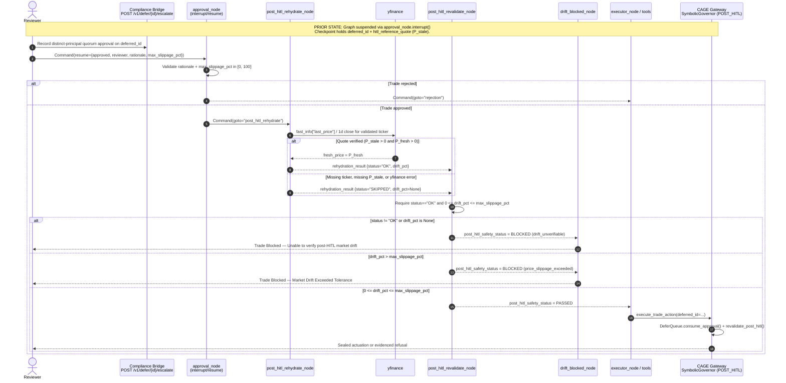

# HITL TOCTOU Remediation — Bounded Resumption Flow

## Overview

This document describes the architectural fix for the **Ghost-State TOCTOU vulnerability** in the CAGE Human-in-the-Loop (HITL) approval workflow, implemented using the **LangGraph interrupt() pattern**. It includes a sequence diagram of the new bounded resumption flow and implementation notes.

**LangGraph interrupt() Pattern:** The HITL gate leverages LangGraph's native `interrupt()` primitive, which suspends graph execution at a designated node boundary and persists state to a durable checkpoint store (Redis). Execution resumes only when an explicit `Command(resume=decision)` is passed to the graph's `.stream()` or `.invoke()` method. This provides deterministic, type-safe suspend/resume semantics with full audit trail preservation.

**CVF Classification:** Formally Unbounded → Bounded (post-remediation)
**STPA Reference:** UCA-2 (Wrong Timing — stale market data at execution)
**ISO 42001:** A.8.4 (AI System Operation Controls), A.7.2 (Accountability)

> **Note — Two distinct TOCTOU mechanisms:** This document covers the **HITL stale-state TOCTOU** (price drift between approval and execution). A separate TOCTOU race — concurrent multi-agent fiscal overspend — is closed by the **FiscalLimitGuard** (Step 3 in `SymbolicGovernor`) using an atomic Lua Redis pre-reservation against `fiscal:daily_limit:{YYYY-MM-DD}`. `ControlBarrierFunction.verify_action()` is **read-only** and does not close that race. See `docs/CAUSAL_AND_CBF_GOVERNANCE.md §3` and `docs/security/STPA_ANALYSIS.md §5`.

---

## The Ghost-State Vulnerability (Before)

```
T=0   Data Analyst: AAPL @ $150.  CBF: SAFE.  OPA: ALLOW.
      Evaluator: APPROVED + governance_signature.
      safety_check_node: APPROVED.
      → interrupt_before=["governed_trader"] fires.
      → approval_node.interrupt() suspends graph.
      → State checkpointed to Redis. Execution paused.

T+Δ   AAPL crashes to $130 (–13%).  Drawdown > 4.5%.

      Reviewer calls POST /v1/approvals/{thread_id}/resume  {"approved": true}
      → Command(resume=decision) passed to graph.astream()
      → Graph resumes from interrupt point
      → approval_node returns goto="executor"   ← NO re-check.  GHOST STATE.
      → execute_trade called with STALE params.
```

**The system was mathematically UNBOUNDED**: actuation could occur on a stale world-model with no mechanism to detect or reject environmental drift.

---

## Remediation Architecture (After)

### Design Principles

| Principle | Implementation |
|-----------|---------------|
| **Bounded intent** — approve an *envelope*, not a point | Reviewer specifies `max_slippage_pct` (`0.0–100.0`); this defines the mathematical acceptance boundary |
| **Check-time quote persistence** — authentic baseline | `data_analyst_node` / `execution_analyst_node` persist `hitl_reference_quote` (`P_stale`) before HITL suspension |
| **Actuation-time sampling** — check at the moment of use | `post_hitl_rehydrate_node` fetches a live quote (`P_fresh`) immediately after resume |
| **Fail-closed slippage & gateway re-validation** — zero false `PASSED` | `post_hitl_revalidate_node` blocks both exceeded drift (`price_slippage_exceeded`) and unverifiable quotes (`drift_unverifiable`, `POAM-2026-240`); on `PASSED`, `execute_trade_action(deferred_id=...)` consumes the approval once in the gateway (`SymbolicGovernor.revalidate_post_hitl()`) |
| **Fail-closed terminal node** — never "bait-and-switch" | `drift_blocked_node` terminates the trade and clears HITL tokens with a human-readable explanation |

---

## Sequence Diagram — Bounded HITL Resumption Flow



---

## Formal Correctness Guarantee

After remediation, actuation requires **both** the advisor's fail-closed reviewer slippage check and the gateway's `POST_HITL` re-validation:

$$\text{ACTUATE} \iff \text{status}_{\text{rehydrate}} = \text{OK} \land \underbrace{\frac{|P_{\text{fresh}} - P_{\text{stale}}|}{P_{\text{stale}}} \leq \delta_{\text{slippage}}}_{\text{Advisor slippage gate}} \land \underbrace{\text{revalidate\_post\_hitl}(\text{deferred\_id}, \text{params}) = \text{ALLOW}}_{\text{Gateway POST\_HITL profile}}$$

Where:
- $P_{\text{fresh}}$ is sampled via `yfinance` at actuation time (not check-time)
- $P_{\text{stale}}$ is the check-time reference quote persisted in `hitl_reference_quote` (or `ExecutionPlan`)
- $\delta_{\text{slippage}}$ is the reviewer's approved tolerance (`max_slippage_pct / 100`)

Unverifiable quotes (`status="SKIPPED"`, missing $P_{\text{stale}}$, missing $P_{\text{fresh}}$, or non-finite values) evaluate to `BLOCKED` (`drift_unverifiable`) and never emit a `PASSED` attestation (`POAM-2026-240`).

---

## Configuration

| Environment Variable | Default | Description |
|---------------------|---------|-------------|
| `HITL_APPROVAL_TTL_SECONDS` | `300` | Approval window TTL in seconds (5 minutes) stamped into `expires_at`. |
| `YFINANCE_TIMEOUT_SECONDS` | `5.0` | Timeout in seconds for check-time and post-HITL `yfinance` quote lookups. |

The default `max_slippage_pct` (`2.0%`) is enforced by [`ApprovalDecision`](../../src/governed_financial_advisor/graph/nodes/approval_contract.py) (`0.0–100.0`) and can be tightened per approval in the `Command(resume=...)` payload.

### Operational Availability Coupling (Known Fail-Closed Property)

Closing the Ghost-State TOCTOU bypass intentionally couples the human-approval execution path to live external market-data availability (`yfinance`, bounded by `YFINANCE_TIMEOUT_SECONDS = 5.0 s`):

1. **Check-time baseline (`DEFAULT_CHECK_TIME_QUOTE_MAX_AGE_S = 60.0 s`):** When a trade reaches [`execution_analyst_node()`](../../src/governed_financial_advisor/graph/nodes/agent_nodes.py) or pre-HITL [`executor_node()`](../../src/governed_financial_advisor/graph/subgraphs/governed_trader_graph.py) without an in-memory `hitl_reference_quote` (`quotes_by_ticker`) younger than `60.0 s`, [`resolve_check_time_reference_quote()`](../../src/governed_financial_advisor/graph/nodes/toctou_quote.py) calls [`fetch_live_yfinance_price()`](../../src/governed_financial_advisor/graph/nodes/toctou_quote.py) to sample $P_{\text{stale}}$ (refusing to fall back to expired same-ticker quotes).
2. **HITL resume (`Command(resume=...)`):** [`post_hitl_rehydrate_node()`](../../src/governed_financial_advisor/graph/subgraphs/governed_trader_graph.py) unconditionally calls [`fetch_live_yfinance_price()`](../../src/governed_financial_advisor/graph/nodes/toctou_quote.py) at resumption time to sample $P_{\text{fresh}}$. While `yfinance` is unreachable, rate-limited, or times out, human-approved trades **cannot execute**: rehydration marks `status = "SKIPPED"`, [`post_hitl_revalidate_node()`](../../src/governed_financial_advisor/graph/subgraphs/governed_trader_graph.py) blocks fail-closed (`drift_unverifiable`), and [`drift_blocked_node()`](../../src/governed_financial_advisor/graph/subgraphs/governed_trader_graph.py) aborts the advisor turn and clears `deferred_id` / `approval_decision` / `hitl_reference_quote` before contacting the gateway (leaving the gateway `DeferQueue` approval unconsumed, though the trade must be re-submitted once market-data connectivity recovers).

---

## Files Changed

| File | Change |
|------|--------|
| [`governed_trader_graph.py`](../../src/governed_financial_advisor/graph/subgraphs/governed_trader_graph.py) | `post_hitl_rehydrate`, `post_hitl_revalidate` (fail-closed on `drift_unverifiable` and `price_slippage_exceeded`), `drift_blocked`, and fail-closed `route_post_revalidation` |
| [`toctou_quote.py`](../../src/governed_financial_advisor/graph/nodes/toctou_quote.py) | Deterministic ticker validation, check-time `hitl_reference_quote` extraction, nested `PlanStep.parameters` support, and JSON plan serialization |
| [`approval_node.py`](../../src/governed_financial_advisor/graph/nodes/approval_node.py) | Dynamic `interrupt()` gate with `ApprovalDecision` validation (`max_slippage_pct` in `[0.0, 100.0]`) and `Command(goto="post_hitl_rehydrate")` |
| [`agent_nodes.py`](../../src/governed_financial_advisor/graph/nodes/agent_nodes.py) | Validated `data_analyst_ticker` + `hitl_reference_quote` capture and `json.dumps` serialization into `governed_trader_node` |
| [`test_hitl_toctou_revalidation.py`](../../tests/test_hitl_toctou_revalidation.py) | Unit and subgraph regression suite guarding `POAM-2026-045` and `POAM-2026-240` |

## DEFER Queue — Confidence-Starved Context Handling

Contexts that are not outright denied but fall below the ALLOW threshold are routed to the **DEFER queue** rather than HITL. This is a distinct path from the HITL approval flow.

### Three-Zone Confidence Model

| Zone | Confidence Range | Action |
|------|-----------------|--------|
| ALLOW | ≥ 0.95 | Execute immediately |
| REQUIRE_APPROVAL | 0.70 – 0.95 | Park in Redis db=1 for human quorum approval |
| DEFER | < 0.70 | Turn-terminal epistemic hold in Redis db=1 |

### DEFER Token Details

- **Redis storage:** `db=1` with `noeviction` maxmemory policy (isolated from LangGraph checkpointer at `db=0`)
- **TTL:** 4 hours (`_DEFAULT_TTL = 14400s`)
- **Key:** `defer:{id}` (Redis Hash)
- **Threshold:** `confidence.defer_floor = 0.70` (`get_confidence_defer_floor()`)

### DEFER Resolution Endpoints

| Method | Path | Description |
|--------|------|-------------|
| `POST` | `/v1/defer/{id}/inject` | Automated data injection resolution — provides missing context for `DEFERRABLE` holds |
| `POST` | `/v1/defer/{id}/escalate` | HITL manual review escalation — records distinct-principal operator approval |
| `GET` | `/v1/defer/pending` | Authenticated listing of pending deferral tokens |

---

## Invariants Preserved

- ✅ Gateway-only KMS asymmetric envelope & routing-seal signing (`POAM-2026-079`, `POAM-2026-080`) — the advisor holds no `SymbolicGovernor` or signing key
- ✅ Non-HITL execution path — goes directly `START → executor → tools`
- ✅ `rejection_node` path — unchanged
- ✅ Fail-closed slippage gate — unverifiable drift (`status != "OK"` or `drift_pct is None`) always blocks (`POAM-2026-240`)
- ✅ Existing HITL rationale / evidence chain — preserved (`max_slippage_pct` validated in `[0.0, 100.0]`)
